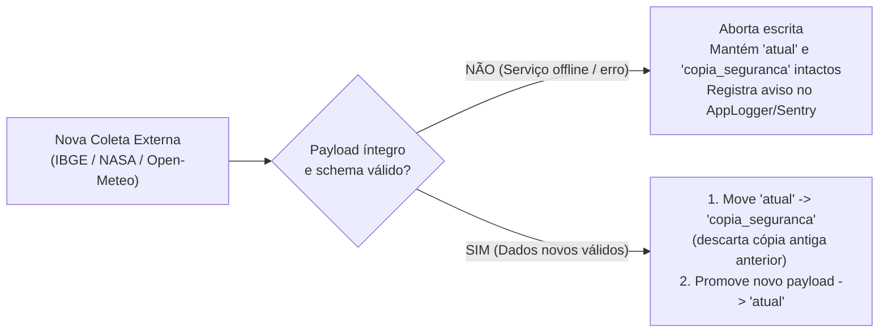

# Arquitetura Unificada: Aba Explorar, Globo Vetorial em 4 LODs, Altimetria NASA e RainTracker

**Ecossistema Aresta Climb (`aresta_app`)**  
*Consolidação Técnica da Fusão Explorar + Mapa Global, Motor Gráfico Offline em 4 LODs, Filtragem Nacional por Grau, Altimetria Externa (NASA NASADEM/SRTM 30m), Malhas IBGE e Sistema Contextual de Umidade Regional com Rotação de Cópia de Segurança*  
**Data:** Novembro de 2026 • **Status:** Especificação Arquitetural Consolidada • **Mudança OpenSpec:** `unificar-explorar-globo-clima`

---

## 1. Resumo Executivo e Motivação

Historicamente, a descoberta de picos no **Aresta Climb** esteve dividida em duas superfícies desconectadas:
1. **`BrowsePage` (`Explorar`)**: uma listagem vertical simples com busca por nome/localidade e ordenação básica, incapaz de filtrar o catálogo nacional por faixa de graduação (`6ºsup–8a`, `V2–V6`) antes do download individual de cada arquivo `.binarypb`.
2. **`MapaGlobalPage`**: uma tela secundária pouco utilizada, acoplada ao plugin nativo `google_maps_flutter` (`PlatformView`), dependente de download contínuo de *tiles* online, pesada em memória RAM em aparelhos modestos e desprovida de contexto climático ou topográfico.

Esta arquitetura unifica as duas frentes em uma **única superfície na aba `Explorar`**, eliminando integralmente a rota legada `MapaGlobalPage` e introduzindo quatro capacidades coordenadas:

1. **Globo 3D Giratório e Terreno Contínuo em 4 LODs (`100% Offline`, `< 4ms`/frame)**: Um motor vetorial leve sobre `CustomPainter` / `Canvas.drawVertices` (com chave instantânea `3D <-> 2D`), que parte do planeta inteiro (`LOD 0`), passa pelas divisas estaduais do IBGE e manchas de chuva (`LOD 1`), inclina sobre serras e vales com curvas de nível de `250m` (`LOD 2`) e chega ao maciço 3D local escalonado pela altitude real do pico com trilha de aproximação animada (`LOD 3`).
2. **Gaveta Deslizante Sincronizada e Busca com Filtro Nacional de Dificuldade**: Uma gaveta em 3 estágios (`Mapa`, `Dividir`, `Lista`) acoplada ao centro óptico da câmera, com auto-scroll animado ao tocar em pinos no mapa, voo parabólico (`Fly-To`), seletor rápido `Grau` ao lado da barra de busca, tag `Paredão` e modal completo de filtros alimentado offline pelo `catalogo.db`.
3. **Sistema Contextual de Chuva Regional (`RainTracker`) em Curva de 5 Dias**: Cruzamento entre células regionais de precipitação e coordenadas dos picos, seguindo a progressão `Muito molhado (2d) -> Molhado (2d) -> Levemente molhado (1d) -> Seco`. Picos secos permanecem limpos (sem selos climáticos); apenas picos sob efeito de chuva exibem o indicador em tons azuis/musgo, a data da chuva (`Chuva DD/MM`) e a estimativa de secagem.
4. **Resiliência contra Quedas de Serviços Externos (Cópia Única de Segurança Rotativa)**: Como APIs governamentais e científicas (**IBGE** e **NASA**) sofrem indisponibilidades periódicas, toda camada de ingestão e armazenamento mantém **exatamente dois slots (`atual` e `copia_seguranca`)**. A cada coleta nova íntegra, o dado anterior substitui a cópia de segurança e versões mais antigas são descartadas, garantindo continuidade operacional sem acúmulo de armazenamento.

```
┌──────────────────────────────────────────────────────────────────────────────────┐
│                     NOVA ARQUITETURA DA ABA EXPLORAR (OFFLINE-FIRST)             │
└──────────────────────────────────────────────────────────────────────────────────┘
         │                                 │                                │
         ▼                                 ▼                                ▼
┌─────────────────────────┐   ┌──────────────────────────┐   ┌─────────────────────────┐
│  GEOMETRIA & RELEVO     │   │  CATÁLOGO & FILTROS      │   │  CLIMA & ALTIMETRIA     │
│  - Malha IBGE (<400 KB) │   │  - SQLite catalogo.db    │   │  - NASA SRTM/NASADEM 30m│
│  - Projeção Contínua    │   │  - Graus Via (1º–12a)    │   │  - Open-Meteo (Cron 3h) │
│  - 4 LODs + Chave 3D/2D │   │  - Graus Boulder (V0–V15)│   │  - Bolhas + Curva 5 dias│
│  - Cópia de Segurança   │   │  - Tag Paredão / Modalid.│   │  - Slots: Atual + Segur.│
└────────────┬────────────┘   └────────────┬─────────────┘   └────────────┬────────────┘
             │                             │                              │
             └─────────────────────────────┼──────────────────────────────┘
                                           ▼
                      ┌─────────────────────────────────────────┐
                      │     BrowseViewModel (MVVM Reativo)      │
                      │  + SuperficieGloboExplorar (<4ms/frame) │
                      │  + GavetaDeslizanteExplorar (3 Snaps)   │
                      └─────────────────────────────────────────┘
```

---

## 2. Conformidade com os Princípios de Engenharia (`AGENTS.md`)

| Princípio | Aplicação Direta nesta Arquitetura |
|---|---|
| **I. Tudo em Português** | Todos os nomes de classes, métodos, variáveis, tabelas SQL, slots (`atual`, `copia_seguranca`), enums (`NivelUmidadePico`, `EstagioGavetaExplorar`) e documentação em português brasileiro. |
| **II. Modularidade (Feature-First)** | Separação clara entre motor matemático de projeção (`controlador_camera_globo.dart`), gerador de relevo (`malha_relevo_lod.dart`), calculadora pura de secagem (`calculadora_umidade_pico.dart`), serviço de rede/cache com rotação (`servico_clima_altimetria.dart`) e widgets de UI passiva. |
| **III & IV. TDD e 100% de Cobertura 1:1** | Cada arquivo `.dart` em `lib/` possui seu `_test.dart` espelhado em `test/`, escrito no ciclo *Red-Green-Refactor*, validando comportamentos observáveis sem inspecionar campos privados. |
| **V. Anti-Mocking e Fakes Testados** | Zero uso de `mocktail`/`mockito`. Testes usam instâncias reais, `catalogo.db` SQLite temporário real, `Directory.systemTemp` real, `HttpServer` local em `127.0.0.1` e `ClienteClimaAltimetriaFake` validado por `cliente_clima_altimetria_fake_test.dart`. |
| **VIII. Fail-Fast + Exceção Explícita** | Remoção integral de `MapaGlobalPage`/`MapaGlobalNode` sem código morto legado. A rotação para `copia_seguranca` diante de queda das APIs do IBGE/NASA é implementada como requisito explícito de domínio documentado e auditado via `AppLogger`. |
| **IX. Orçamento de Meio Frame (`< 4ms`)** | Decodificação de JSON/binários geográficos e agregação inicial de graus ocorrem fora do frame de pintura (`Isolate.run` / pré-cálculo assíncrono). O `CustomPainter` opera sobre buffers planos pré-alocados e só repinta quando há gesto ou `Ticker` ativo (`0%` CPU parado). |

---

## 3. Experiência Visual, Hierarquia Limpa e Motor de 4 LODs

### 3.1. Fusão de Tela e Remoção de Poluição Visual
A aba `Explorar` abandona a antiga separação lista/mapa e adota uma composição em três camadas sobrepostas:

1. **Superfície de Fundo (Tela Cheia)**: `SuperficieGloboExplorar` ocupando 100% da área útil, sem botões de zoom `+`/`−` redundantes (o usuário usa pinça ou duplo-toque). Apenas uma cápsula compacta `3D/2D | 🌍` flutua discretamente no canto superior direito.
2. **Barra Superior Unificada (`BarraBuscaFiltrosExplorar`)**:
   * Campo de busca difusa (`Pico, cidade, via ou serra...`) com botão de limpeza `✕`.
   * Botão rápido **`Grau`** imediatamente ao lado da busca: abre um popover enxuto com dois controles deslizantes duplos (`RangeSlider`) — **Vias (`1º` a `12a`)** e **Boulder (`V0` a `V15`)**. Quando ativo, o próprio botão exibe o recorte (ex.: `7a–8b`).
   * Botão **`Filtros e Ordenação`** (`Icons.tune_rounded`) com contador numérico de filtros ativos, abrindo o modal completo alinhado ao `PainelFiltrosIndice`.
   * Linha horizontal opcional de chips ativos removíveis (`Via 7a–8b ✕`, `Paredão ✕`, `< 150 km ✕`) que só ocupa espaço quando há filtro aplicado.
3. **Gaveta Inferior em 3 Posições (`GavetaDeslizanteExplorar`)**:
   * **Estágio `Mapa` (~66px)**: recolhe a lista exibindo apenas a alça, contagem de picos encontrados e seletor rápido de estágio, liberando quase toda a tela para girar o globo e inspecionar bolhas de chuva.
   * **Estágio `Dividir` (~36% da tela)**: visão padrão equilibrada entre mapa acima e cards abaixo, acompanhada das pílulas rápidas de modalidade (`Esportiva`, `Boulder`, `Móvel / Trad`, `Paredão`).
   * **Estágio `Lista` (~80% da tela)**: imersão de catálogo para leitura comparativa rápida.

### 3.2. Projeção Matemática Contínua (Câmera Única sem Cortes)
Para eliminar qualquer corte brusco ou *crossfade* artificial entre o globo e a montanha local, todos os 4 LODs compartilham **uma única equação de projeção** controlada pela variável contínua `lod` $\in [0{,}0,\; 3{,}2]$.

O raio aparente do planeta escala exponencialmente com `lod`:

$$R(\text{lod}) = R_0 \cdot b^{\text{lod}} \quad \text{com } R_0 = 142\text{ px},\; b = 7{,}6$$

* Em `lod = 0,0`, $R = 142\text{ px}$ (o hemisfério inteiro cabe na largura do celular).
* Em `lod = 3,0`, $R \approx 62.300\text{ px}$ (uma janela de `~20 km` ao redor do pico preenche a tela).

Dada uma coordenada geográfica $(\phi, \lambda)$ e elevação $h$ (em metros acima do nível do mar), centrada no foco da câmera $(\phi_0, \lambda_0)$:

1. **Rotação para o referencial esférico local**:
   $$x_0 = \cos\phi \sin(\lambda - \lambda_0)$$
   $$y_0 = \cos\phi_0 \sin\phi - \sin\phi_0 \cos\phi \cos(\lambda - \lambda_0)$$
   $$z_0 = \sin\phi_0 \sin\phi + \cos\phi_0 \cos\phi \cos(\lambda - \lambda_0)$$
   Pontos no hemisfério oculto ($z_0 < 0{,}015$) são descartados imediatamente (*backface culling*).

2. **Extrusão Topográfica Contínua**:
   $$r = 1 + \frac{\max(0, h)}{R_{\text{Terra}}} \cdot k_{\text{exagero}}$$
   Como $h / R_{\text{Terra}}$ é multiplicado por $R(\text{lod})$ na tela, uma montanha de `1.500m` mede naturalmente `0,2 px` no `LOD 0` (esfera lisa) e cresce suavemente até `~110 px` de relevo vertical no `LOD 3`, sem nenhuma troca de cena.

3. **Órbita Azimutal ($\psi$) e Inclinação Progressiva ($\theta$)**:
   No modo `3D`, a inclinação da câmera $\theta(\text{lod}) = \text{smoothstep}(1{,}50,\; 2{,}75,\; \text{lod}) \cdot 54^\circ$ rotaciona o plano tangente ao redor do ponto focado $(0, 0, 1)$, aplicando perspectiva suave no horizonte. No modo `2D`, $\theta = 0^\circ$ e $\psi = 0^\circ$, projetando o mesmo terreno como carta topográfica plana.

### 3.3. Tabela de Detalhamento dos 4 LODs

| Nível | Faixa de `lod` | Elementos de Mapa | Comportamento dos Marcadores |
|---|---|---|---|
| **`LOD 0` • Globo** | `0.00 – 0.75` | Oceano com iluminação esférica, aura atmosférica, América do Sul, África Ocidental, Brasil e brilho sinótico das bolhas de chuva. | **Clusters neutros por UF** (`MG · 14`, `RJ · 9`, `SP · 6`), zero sobreposição de nomes de picos. Toque aproxima para `LOD 1`. |
| **`LOD 1` • Região** | `0.75 – 1.65` | Divisas estaduais oficiais (IBGE) e **bolhas regionais orgânicas de chuva** (núcleo + halo translúcido + perímetro tracejado). | Pinos individuais com **prevenção automática de colisão**: picos espaçados ou selecionados mostram nome; vizinhos densos exibem ponto limpo até aproximar. |
| **`LOD 2` • Serra e Vale** | `1.65 – 2.50` | Câmera inicia inclinação (`0° -> 32°`), lente circular de terreno sombreado por encosta, **curvas de nível a cada `250m`** e bolhas de chuva drapiadas sobre o relevo. | Pílulas com nome completo e altitude (`Serra do Cipó · 1120m`). |
| **`LOD 3` • Maciço 3D** | `2.50 – 3.20` | Câmera alpina (`~54°`) com névoa atmosférica ao fundo, maciço 3D escalonado por `altitude_pico_m`, **curvas finas a cada `80m`** e trilha de aproximação animada. | Cume destacado com altitude + micro-marcadores de setor principal e base/estacionamento. |

---

## 4. Micro-Animações e Sincronia Mapa <-> Lista

Todas as animações operam exclusivamente sobre transformações e parâmetros de câmera/scroll, mantendo custo inferior a `1,5 ms` por quadro:

1. **Auto-Scroll Sincronizado e Destaque no Card**:
   * A lista na gaveta preserva sempre a ordem de classificação ativa (`Mais próximos`, `Mais escaladas`, `A–Z`).
   * Quando o usuário toca em um pino no mapa:
     1. Se a gaveta estiver recolhida em `Mapa`, ela desliza automaticamente para `Dividir` (`280ms`, `Curves.easeOutCubic`).
     2. O `ScrollController` rola suavemente (`320ms`) até enquadrar o card daquele pico no topo visível da gaveta.
     3. O card recebe um pulso sutil de borda terracota (`560ms`) para guiar o olhar do usuário.
2. **Onda Sonar no Pino + Realce Causa-Efeito da Bolha de Chuva**:
   * O pino clicado emite um anel concêntrico expansivo. Caso o pico esteja úmido, o contorno da bolha de chuva que o atingiu acende brevemente, explicando visualmente qual frente chuvosa afetou aquele setor.
3. **Voo Parabólico (`Fly-To`)**:
   * Ao selecionar um pico distante (`> 250 km`) pela lista ou busca, a câmera executa interpolação cúbica em `(lat, lon)` combinada a um recuo parabólico temporário de zoom ($\Delta \text{lod} = -d \sin(\pi t)$), subindo sutilmente sobre os estados antes de pousar no destino.
4. **Centro Óptico Acoplado à Gaveta**:
   * O deslocamento vertical `cy` da projeção lê diretamente a altura instantânea da gaveta (`ValueListenable<double>`), mantendo o pico selecionado sempre centralizado na janela útil acima da gaveta enquanto o usuário a arrasta.
5. **Traçado Progressivo da Trilha no `LOD 3`**:
   * Ao ingressar no `LOD 3`, a linha tracejada da trilha de aproximação desenha-se progressivamente (`0 -> 100%` em `450ms`) da base até a parede.

---

## 5. Fontes Externas de Dados: IBGE, NASA (NASADEM/SRTM 30m) e Open-Meteo

### 5.1. Separação de Responsabilidades por Provedor Externo

| Dado Necessário | Fonte Externa Escolhida | Frequência de Coleta | Justificativa Técnica |
|---|---|---|---|
| **Divisas Estaduais e Costa Brasileira** (`LOD 0–1`) | **API de Malhas do IBGE** (`servicodados.ibge.gov.br/api/v3/malhas`) + Natural Earth | Tempo de build / atualização de release | O IBGE fornece os contornos políticos oficiais das 27 UFs em GeoJSON. *(Nota: as APIs altimétricas do IBGE como `BDG`/`hgeoHNOR` atendem apenas marcos geodésicos de estrada, não oferecendo grade DEM contínua).* |
| **Altimetria de Base e Cume dos Picos** (`Alt. <N>m` e `LOD 3`) | **NASA NASADEM / SRTM GL1 (`30m`)** via *OpenTopography* / *Registry of Open Data Terrain Tiles* | **1x por pico inédito** (dado geográfico estático) | Resolução espacial de **30 metros** (`3x` superior a grades meteorológicas de `90m+`). Evita achatar monólitos estreitos (Pão de Açúcar, Pedra do Baú, Quixadá) e permite medir uma janela de `~2,5 km` ao redor do estacionamento para separar `altitude_base_m` de `altitude_pico_m`. |
| **Precipitação Diária e Bolhas Regionais** (`RainTracker`) | **Open-Meteo Forecast API** (`past_days=5`, `daily=precipitation_sum`) via Cron no Supabase | **A cada 3 horas** (agregado no servidor) | Zero atraso temporal (inclui chuva da madrugada/hoje) e consulta até 100 pontos por requisição sem chave paga. *(A API pública `NASA POWER PRECTOTCORR` possui 2 a 3 dias de latência de calibração satelital e grade de `55 km`, o que ocultaria tempestades da véspera).* |

---

## 6. Armazenamento de Cópia Única de Segurança (`atual` + `copia_seguranca`)

Serviços públicos governamentais e científicos (**IBGE** e repositórios ligados a dados **NASA/SRTM**) passam com frequência por janelas de manutenção, instabilidades de DNS ou timeouts (`HTTP 502/503/504`).

Para garantir disponibilidade contínua **sem acumular histórico infinito de versões**, todas as três camadas externas seguem estritamente o protocolo de **Rotação Atômica de Dois Slots (`atual` + `copia_seguranca`)**:



### 6.1. Invariantes da Cópia de Segurança
1. **Exatamente 1 cópia anterior**: Nunca existem tabelas ou arquivos `_v1`, `_v2`, `_v3`. Apenas dois estados coexistem: `atual` e `copia_seguranca`.
2. **Validação Prévia Obrigatória**: Nenhum dado recém-baixado entra em `atual` nem empurra `atual` para `copia_seguranca` antes de passar por validação completa de integridade (JSON válido, coordenadas finitas, altitudes dentro de `[-50m, 4000m]`, 27 UFs presentes no caso do IBGE). Assim, uma resposta de erro HTML `503` jamais contamina `atual` nem destrói `copia_seguranca`.
3. **Aplicação nas 3 Camadas**:
   * **Build / Tooling (`frontend/tool/gerar_malha_geografica_offline.dart`)**: Mantém `malha_globo_brasil.json` + `malha_globo_brasil.seguranca.json` e `altimetria_picos_inicial.json` + `altimetria_picos_inicial.seguranca.json`. Se IBGE ou NASA estiverem offline durante a execução da ferramenta, preserva/restaura automaticamente a cópia de segurança validada; quando online com novos dados, atualiza a cópia de segurança e descarta o arquivo antigo.
   * **Supabase PostgreSQL (`public.estado_clima_picos` e `public.snapshots_altimetria_picos`)**: Ambas as tabelas operam com chave `slot TEXT PRIMARY KEY CHECK (slot IN ('atual', 'copia_seguranca'))` atualizada via função PL/pgSQL transacional `public.rotacionar_snapshot_clima(...)` e `public.rotacionar_snapshot_altimetria(...)`.
   * **Cliente Flutter (`ArmazenamentoClimaLocal`)**: Grava primeiro em `.tmp`, move `<docs>/clima_altimetria_atual.json` sobre `<docs>/clima_altimetria_seguranca.json` (descartando o anterior) e renomeia `.tmp` para `atual`. Em leitura, se `atual` estiver corrompido por desligamento abrupto durante escrita, restaura de `copia_seguranca`.

### 6.2. Esquema SQL Idempotente no Supabase

```sql
-- Tabela de snapshots de clima (estritamente 2 linhas: 'atual' e 'copia_seguranca')
CREATE TABLE IF NOT EXISTS public.estado_clima_picos (
    slot TEXT PRIMARY KEY CHECK (slot IN ('atual', 'copia_seguranca')),
    gerado_em TIMESTAMPTZ NOT NULL,
    bolhas_chuva JSONB NOT NULL,
    chuva_por_pico JSONB NOT NULL,
    atualizado_em TIMESTAMPTZ NOT NULL DEFAULT now()
);

-- Tabela de snapshots consolidados de altimetria NASA 30m (estritamente 2 linhas)
CREATE TABLE IF NOT EXISTS public.snapshots_altimetria_picos (
    slot TEXT PRIMARY KEY CHECK (slot IN ('atual', 'copia_seguranca')),
    gerado_em TIMESTAMPTZ NOT NULL,
    altimetria_por_pico JSONB NOT NULL,
    atualizado_em TIMESTAMPTZ NOT NULL DEFAULT now()
);

-- Rotação atômica: promove 'atual' anterior para 'copia_seguranca' (descartando o antigo) e grava o novo 'atual'
CREATE OR REPLACE FUNCTION public.rotacionar_estado_clima_picos(
    p_gerado_em TIMESTAMPTZ,
    p_bolhas_chuva JSONB,
    p_chuva_por_pico JSONB
) RETURNS void
LANGUAGE plpgsql
SECURITY DEFINER
SET search_path = public
AS $$
BEGIN
    INSERT INTO public.estado_clima_picos (slot, gerado_em, bolhas_chuva, chuva_por_pico, atualizado_em)
    SELECT 'copia_seguranca', gerado_em, bolhas_chuva, chuva_por_pico, now()
    FROM public.estado_clima_picos
    WHERE slot = 'atual'
    ON CONFLICT (slot) DO UPDATE SET
        gerado_em = EXCLUDED.gerado_em,
        bolhas_chuva = EXCLUDED.bolhas_chuva,
        chuva_por_pico = EXCLUDED.chuva_por_pico,
        atualizado_em = now();

    INSERT INTO public.estado_clima_picos (slot, gerado_em, bolhas_chuva, chuva_por_pico, atualizado_em)
    VALUES ('atual', p_gerado_em, p_bolhas_chuva, p_chuva_por_pico, now())
    ON CONFLICT (slot) DO UPDATE SET
        gerado_em = EXCLUDED.gerado_em,
        bolhas_chuva = EXCLUDED.bolhas_chuva,
        chuva_por_pico = EXCLUDED.chuva_por_pico,
        atualizado_em = now();
END;
$$;
```

### 6.3. Formato Compacto do Payload JSON (`~5 KB` no Cliente)

```json
{
  "slot": "atual",
  "gerado_em": "2026-11-25T15:00:00Z",
  "bolhas_chuva": [
    {
      "id": "quadrilatero_20261125",
      "lat": -20.04,
      "lon": -44.24,
      "raio_lon_graus": 0.72,
      "raio_lat_graus": 0.54,
      "rotacao_rad": -0.35,
      "precipitacao_mm": 22.0,
      "data_chuva": "2026-11-25"
    }
  ],
  "chuva_por_pico": {
    "br_mg_igarape_pedra_grande": [
      { "data": "2026-11-25", "mm": 22.0, "bolha_id": "quadrilatero_20261125" }
    ],
    "br_mg_santana_do_riacho_serra_do_cipo": [
      { "data": "2026-11-24", "mm": 9.4, "bolha_id": "cipo_sul_20261124" }
    ]
  }
}
```

---

## 7. Máquina de Estados da Umidade (`CalculadoraUmidadePico`)

### 7.1. Progressão de 5 Dias
A secagem da rocha segue uma progressão encadeada onde cada estágio decai para o próximo até atingir `Seco`:

```
  Chuva >= 15 mm          Chuva 5 a < 15 mm       Chuva 1 a < 5 mm
        │                         │                       │
        ▼                         ▼                       ▼
┌────────────────┐       ┌────────────────┐      ┌───────────────────┐     ┌────────┐
│ MUITO MOLHADO  │ 2d ──►│    MOLHADO     │ 2d ─►│ LEVEMENTE MOLHADO │ 1d ►│  SECO  │
│  Azul Índigo   │       │   Azul Médio   │      │  Verde Musgo App  │     │ Neutro │
└────────────────┘       └────────────────┘      └───────────────────┘     └────────┘
  Total até Seco: 5 dias   Total até Seco: 3 dias  Total até Seco: 1 dia
```

Para um evento de chuva de volume $m$ ocorrido há $d$ dias inteiros ($d = \text{dataAtual} - \text{dataChuva} \ge 0$):
* **Se $m \ge 15{,}0\text{ mm}$**:
  * $d \in \{0, 1\} \Rightarrow$ `Muito molhado` (faltam $5 - d$ dias para secar)
  * $d \in \{2, 3\} \Rightarrow$ `Molhado` (faltam $5 - d$ dias para secar)
  * $d = 4 \Rightarrow$ `Levemente molhado` (falta $1$ dia para secar)
  * $d \ge 5 \Rightarrow$ `Seco`
* **Se $5{,}0 \le m < 15{,}0\text{ mm}$**:
  * $d \in \{0, 1\} \Rightarrow$ `Molhado` (faltam $3 - d$ dias para secar)
  * $d = 2 \Rightarrow$ `Levemente molhado` (falta $1$ dia para secar)
  * $d \ge 3 \Rightarrow$ `Seco`
* **Se $1{,}0 \le m < 5{,}0\text{ mm}$**:
  * $d = 0 \Rightarrow$ `Levemente molhado` (falta $1$ dia para secar)
  * $d \ge 1 \Rightarrow$ `Seco`
* **Se $m < 1{,}0\text{ mm}$**: `Seco`.

Quando há mais de um dia chuvoso nos últimos 5 dias para o mesmo pico, avalia-se cada registro e prevalece aquele com maior nível vigente na data atual (desempatando pelo maior número de dias restantes de secagem).

### 7.2. Comportamento Passivo na UI
* **Proibição de Abas de Umidade**: Não existem abas `Secos` ou `Úmidos` na navegação.
* **Silêncio Visual em Rocha Seca**: Quando o resultado é `Seco`, o card do pico e seu marcador no mapa exibem zero ícones ou textos climáticos.
* **Aviso Contextual sob Impacto**: Apenas quando o pico está em `Muito molhado`, `Molhado` ou `Levemente molhado`, o card exibe a faixa compacta com nível, data (`Chuva 24/11`) e estimativa (`~3d p/ secar`), e o pino recebe o anel colorido correspondente dentro da bolha regional.

---

## 8. Filtragem Nacional Offline por Grau e Modalidade (`catalogo.db`)

Todo dispositivo já possui localmente o banco SQLite `catalogo.db` contendo a tabela `catalogo_aresta` (`uid`, `tipo`, `croqui_uid`, `nome`, `escalada_grau`, `escalada_tipo`) sincronizada por deltas.

1. **Agregação de Perfis de Grau em Memória (`RepositorioCatalogo.carregarPerfisGrauPorCroqui`)**:
   * Executa uma leitura sequencial indexada das linhas `tipo = 'escalada'`, convertendo `escalada_grau` para os pesos numéricos canônicos de `filtro_grau_escalada.dart` (`OpcoesGrau.grausVia` de `1º` a `12a` e `OpcoesGrau.grausBoulder` de `V0` a `V15`).
   * Constrói em `< 3 ms` um mapa imutável `Map<String, PerfilGrauPico>` indexado por `id_slug`/`croqui_uid` contendo máscaras de bits das faixas de grau presentes em cada pico.
   * O cache em memória é invalidado automaticamente sempre que `RepositorioCatalogo.versaoNotificador` incrementa.
2. **Modalidades e Terminologia**:
   * As tags rápidas da gaveta e do modal de filtros usam: `Esportiva`, `Boulder`, `Móvel / Trad`, **`Paredão`** (mapeado sobre `totalMultiplasEnfiadas` / `multienfiada`) e `Highline`.

---

## 9. Estrutura de Módulos e Plano de Execução (TDD 1:1)

### 9.1. Mapa de Novos Arquivos e Espelhamento de Testes

| Arquivo de Produção (`frontend/lib/...`) | Arquivo de Teste Espelhado (`frontend/test/...`) |
|---|---|
| `services/clima/modelos_clima_pico.dart` | `services/clima/modelos_clima_pico_test.dart` |
| `services/clima/calculadora_umidade_pico.dart` | `services/clima/calculadora_umidade_pico_test.dart` |
| `services/clima/armazenamento_clima_local.dart` | `services/clima/armazenamento_clima_local_test.dart` |
| `services/clima/servico_clima_altimetria.dart` | `services/clima/servico_clima_altimetria_test.dart` |
| *(test-only)* `test/fakes/cliente_clima_altimetria_fake.dart` | `test/fakes/cliente_clima_altimetria_fake_test.dart` |
| `widgets/explorar/controlador_camera_globo.dart` | `widgets/explorar/controlador_camera_globo_test.dart` |
| `widgets/explorar/malha_relevo_lod.dart` | `widgets/explorar/malha_relevo_lod_test.dart` |
| `widgets/explorar/superficie_globo_explorar.dart` | `widgets/explorar/superficie_globo_explorar_test.dart` |
| `widgets/explorar/barra_busca_filtros_explorar.dart` | `widgets/explorar/barra_busca_filtros_explorar_test.dart` |
| `widgets/explorar/gaveta_deslizante_explorar.dart` | `widgets/explorar/gaveta_deslizante_explorar_test.dart` |

### 9.2. Arquivos Legados Removidos (Corte Limpo)
* `frontend/lib/pages/mapa_global.dart` e `frontend/test/pages/mapa_global_test.dart`
* `frontend/lib/view/view_models/mapa_global_view_model.dart` e respectivo teste
* `MapaGlobalNode` em `frontend/lib/navigation/arvore/nos_globais.dart` e `AppNav.toMapaGlobal` em `funcoes_navegacao.dart`

### 9.3. Sequência de Fases de Implementação
1. **Fase 1 — Infraestrutura SQL e Assets com Cópia de Segurança**: Criar `docs/arquitetura/sql/supabase_clima_e_altimetria_picos.sql` (com funções de rotação de 2 slots) e `frontend/tool/gerar_malha_geografica_offline.dart` gerando os assets de malha IBGE e altimetria inicial NASA 30m + respectivas cópias `.seguranca.json`.
2. **Fase 2 — Domínio de Clima, Altimetria e Rotação Local**: Implementar `CalculadoraUmidadePico`, `ArmazenamentoClimaLocal` (com rotação `.tmp -> copia_seguranca -> atual`), `ClienteClimaAltimetriaFake` e `ServicoClimaAltimetria`.
3. **Fase 3 — Perfis de Grau no `RepositorioCatalogo` e `BrowseViewModel`**: Adicionar agregação de graus de `catalogo_aresta` e expandir `BrowseViewModel` com filtros de grau, tag `Paredão`, altitude, umidade contextual e estado de seleção mapa-lista.
4. **Fase 4 — Motor Vetorial de 4 LODs (`SuperficieGloboExplorar`)**: Implementar câmera contínua `3D/2D`, `Fly-To` parabólico, clusters de estado, bolhas de chuva, curvas de nível, relevo `LOD 3`, trilha animada e onda sonar.
5. **Fase 5 — Barra de Busca/Grau, Gaveta Sincronizada e Integração em `BrowsePage`**: Conectar auto-scroll animado, destaque de card, popover `Grau` e modal completo de filtros.
6. **Fase 6 — Remoção de `MapaGlobalPage`, Documentação e Auditoria 100% LCOV**: Remover rotas legadas, atualizar `README.md`s e validar `flutter analyze` + `100%` de cobertura em `lcov.info`.
