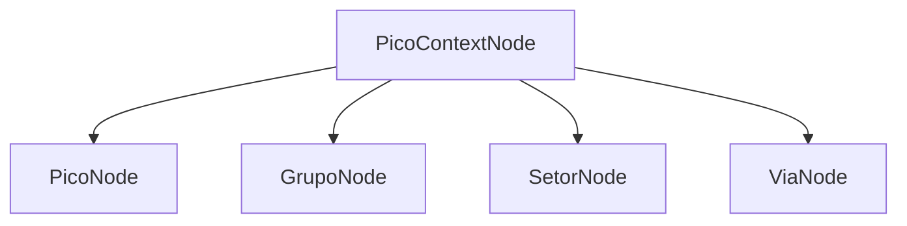

# Navegação (`lib/navigation/`)

Este diretório implementa a navegação do aplicativo com uma **Árvore de Nós** (`ArvoreNavegacao` / `NavegadorArvore`) em substituição ao empilhamento direto de rotas (`Navigator.push`).

## Funcionamento da Árvore

Na exploração de guias (`Pico -> Setor -> Via -> Mapa -> Via`), empilhar rotas cria duplicatas na pilha e exige múltiplos toques para voltar. Na árvore de navegação, o estado guarda o nó atual (`currentNode`) e sua cadeia de pais (`parent`). Se o usuário navegar para um nó que já está entre os ancestrais ativos, a árvore retorna àquele nó em vez de empilhar outra instância.

## Estrutura de Arquivos

```text
lib/navigation/
├── arvore/
│   ├── no_navegacao.dart                - Classe base NavNode, rotuloAmigavel e obterCaminhoCurto()
│   ├── nos_globais.dart                 - Nós globais (HomeNode, BrowseNode, MeusCroquisNode, ComunidadeNode, SettingsNode, LoginNode, PerfilNode, CadernetaNode, SobreTimeNode, EstatisticasClimaNode, GPSNode)
│   ├── nos_pico.dart                    - Nós de escalada (PicoNode, SetoresNode, IndiceEscaladasNode, GrupoNode, SetorNode, ViaNode, ExplorarLocalNode, ComunidadePicoNode, ApoiePicoNode)
│   ├── nos_modais.dart                  - Nós de modais e carrosséis (TextNode, TextCarouselNode, MapasCarrosselNode)
│   ├── modelo_arvore_navegacao.dart     - Regras de transição, prevenção de ciclos, salto de Perfil deslogado e poda de nós
│   └── navegador_arvore.dart            - Controlador ChangeNotifier (TreeNavigationController / NavegadorArvore)
├── arvore_navegacao.dart                - Reexportação dos módulos de arvore/
├── construtor_reativo_pagina.dart       - PageListenableBuilder (resolução de IDs para objetos Protobuf atuais)
├── construtor_view_arvore.dart          - Mapeamento de NavNode para páginas e modais Flutter
├── wrapper_navegacao_arvore.dart        - Widget raiz com IndexedStack das abas e Navigator declarativo
├── funcoes_navegacao.dart               - API estática AppNav
├── hierarquia_mapas.dart                - Resolução de destino superior ("Subir") entre mapas de setor, grupo e pico
├── pagina_modal_bottom_sheet.dart       - Page declarativa para exibição de BottomSheets na árvore
├── analisador_rotas_deep_link.dart      - Parser de URLs aresta.cc, /croquis e placas legadas
├── localizador_destino_uid.dart         - Resolução de NanoID 14c para NavNode via memória, disco e catalogo.db
├── servico_navegacao_deep_link.dart     - Execução de transições de deep link e filtro de callbacks OAuth
└── gerenciador_deep_links.dart          - Escuta de links externos em cold start e warm start
```

## Deep Links (`aresta.cc` e `arestaclimb.com`)

- **Rotas suportadas**:
  - `https://aresta.cc/<uid>` e `https://aresta.cc/m/<uid>` (abre no mapa).
  - `https://aresta.cc/s/<uid>` e `https://aresta.cc/sm/<uid>` (`/ms/<uid>`): compartilhamento (`origem_link: 'compartilhamento'`).
  - `https://aresta.cc/q/<uid>` e `https://aresta.cc/qm/<uid>` (`/mq/<uid>`): placas QR Code (`origem_link: 'qrcode'`).
  - `https://arestaclimb.com/croquis/<uid>[/<slug>]` e `aresta://arestaclimb.com/croquis/...` com suporte a `?mapa=1` e parâmetros UTM.
  - Mapeamento estático das 8 placas antigas em `app.arestaclimb.com/br_mg_igarape_pedra_grande/...`.
- **Resolução (`LocalizadorDestinoUid`)**: Busca o NanoID 14c no índice em memória, em `/downloads`, em `/temp_cache`, na sessão online e no `catalogo.db`. Quando o croqui não está disponível localmente e o aparelho está offline, retorna os dados do catálogo para exibição do `ModalCroquiSemConexao`.

## Componentes Principais

- **`NavNode`**: Armazena somente identificadores em texto (`cragId`, `setorNome`, `escaladaNome`, `mapaCaminhoImagem`), sem reter instâncias Protobuf.
- **`ArvoreNavegacao`**: Imutável. Calcula transições (`navegarPara`), retorno (`voltar`, saltando `PerfilNode` quando o usuário não está autenticado), retorno à raiz (`irParaRaiz`) e remoção de nós de perfil/caderneta (`podarNosPerfilECaderneta`) quando as interações são desativadas nas configurações.
- **`PageListenableBuilder`**: Lê os IDs do `NavNode` e injeta os objetos atuais de `DatasetRepository` na página, atualizando a UI quando o croqui muda em segundo plano.
- **`TreeNavigationWrapper`**: Mantém as 4 abas base em um `IndexedStack`, constrói `Navigator(pages: ...)` para os nós empilhados e trata o botão voltar do sistema via `PopScope`.

## Uso da API `AppNav`

```dart
// Navegação para páginas da árvore
AppNav.toPico(context, cragId: id);
AppNav.toSetor(context, setor: setor);
AppNav.toVia(context, escalada: escalada, setor: setor);
AppNav.toMapas(context, cragId: id, mapas: itens);
AppNav.abrirPerfilOuLogin(context);
AppNav.toSettings(context);

// Voltar um nível (acionado por toque no BotaoVoltarComRetornoInicio)
AppNav.back(context);

// Desempilhar rotas imperativas sobrepostas e voltar para HomeNode
// (acionado ao manter pressionado o BotaoVoltarComRetornoInicio)
AppNav.home(context);
```

> **Rotas Imperativas**: `Navigator.push` e `showModalBottomSheet` são reservados para fluxos auxiliares que retornam valor ou não compõem a árvore de conteúdo (`QRScannerPage`, `TermosDeUsoPage`, `PicoSearchDelegate` e diálogos).

## Hierarquia de Telas vs. Herança de Classes

Na navegação, `ViaNode` tem `SetorNode` ou `PicoNode` como `parent`. No código Dart, `PicoNode`, `GrupoNode`, `SetorNode` e `ViaNode` são subclasses diretas de `PicoContextNode` (que define `cragId`):


