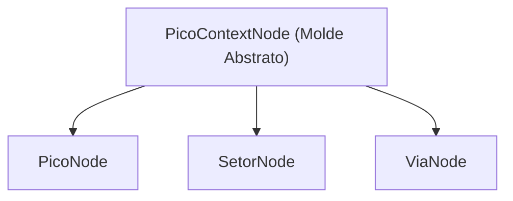

# Navegação (`lib/navigation/`)

Este diretório implementa a navegação do aplicativo com uma **Árvore de Nós** (`ArvoreNavegacao` / `NavegadorArvore`) em substituição ao empilhamento direto de rotas (`Navigator.push`).

## Funcionamento da Árvore

Na exploração de guias (`Pico -> Setor -> Via -> Mapa -> Via`), empilhar rotas cria duplicatas na pilha e exige múltiplos toques para voltar. Na árvore de navegação, o estado guarda o nó atual (`currentNode`) e sua cadeia de pais (`parent`). Se o usuário navegar para um nó que já está entre os ancestrais ativos, a árvore retorna àquele nó em vez de empilhar outra instância.

## Estrutura de Arquivos

```text
lib/navigation/
├── arvore/
│   ├── no_navegacao.dart                - Classe base NavNode, rotuloAmigavel e obterCaminhoCurto()
│   ├── nos_globais.dart                 - Nós globais (HomeNode, BrowseNode, MeusCroquisNode, ComunidadeNode, MapaGlobalNode, SettingsNode, LoginNode, PerfilNode, CadernetaNode, SobreTimeNode, GPSNode)
│   ├── nos_pico.dart                    - Nós de escalada (PicoNode, SetoresNode, IndiceEscaladasNode, GrupoNode, SetorNode, ViaNode, ExplorarLocalNode, ComunidadePicoNode, ApoiePicoNode)
│   ├── nos_modais.dart                  - Nós de modais e carrosséis (TextNode, TextCarouselNode, MapasCarrosselNode)
│   ├── modelo_arvore_navegacao.dart     - Regras de transição, prevenção de ciclos, salto de Perfil deslogado e poda de nós
│   └── navegador_arvore.dart            - Controlador ChangeNotifier (TreeNavigationController / NavegadorArvore)
├── arvore_navegacao.dart                - Reexportação dos módulos de arvore/
├── construtor_reativo_pagina.dart       - PageListenableBuilder (resolução de IDs para objetos Protobuf atuais)
├── construtor_view_arvore.dart          - Mapeamento de NavNode para páginas e modais Flutter
├── wrapper_navegacao_arvore.dart        - Widget raiz com IndexedStack das abas e Navigator declarativo
├── funcoes_navegacao.dart               - API estática AppNav
├── hierarquia_mapas.dart                - Resolução de destino superior ("Subir") entre mapas de setor, grupo e pico
├── pagina_modal_bottom_sheet.dart       - Page declarativa para exibição de BottomSheets na árvore
├── analisador_rotas_deep_link.dart      - Parser de URLs aresta.cc, /croquis e placas legadas
├── localizador_destino_uid.dart         - Resolução de NanoID 14c para NavNode via memória, disco e catalogo.db
├── servico_navegacao_deep_link.dart     - Execução de transições de deep link e filtro de callbacks OAuth
└── gerenciador_deep_links.dart          - Escuta de links externos em cold start e warm start
```

## Deep Links (`aresta.cc` e `arestaclimb.com`)

- **Rotas suportadas**:
  - `https://aresta.cc/<uid>` e `https://aresta.cc/m/<uid>` (abre no mapa).
  - `https://aresta.cc/s/<uid>` e `https://aresta.cc/sm/<uid>` (`/ms/<uid>`): compartilhamento (`origem_link: 'compartilhamento'`).
  - `https://aresta.cc/q/<uid>` e `https://aresta.cc/qm/<uid>` (`/mq/<uid>`): placas QR Code (`origem_link: 'qrcode'`).
  - `https://arestaclimb.com/croquis/<uid>[/<slug>]` e `aresta://arestaclimb.com/croquis/...` com suporte a `?mapa=1` e parâmetros UTM.
  - Mapeamento estático das 8 placas antigas em `app.arestaclimb.com/br_mg_igarape_pedra_grande/...`.
- **Resolução (`LocalizadorDestinoUid`)**: Busca o NanoID 14c no índice em memória, em `/downloads`, em `/temp_cache`, na sessão online e no `catalogo.db`. Quando o croqui não está disponível localmente e o aparelho está offline, retorna os dados do catálogo para exibição do `ModalCroquiSemConexao`.

## Componentes Principais

- **`NavNode`**: Armazena somente identificadores em texto (`cragId`, `setorNome`, `escaladaNome`, `mapaCaminhoImagem`), sem reter instâncias Protobuf.
- **`ArvoreNavegacao`**: Imutável. Calcula transições (`navegarPara`), retorno (`voltar`, saltando `PerfilNode` quando o usuário não está autenticado), retorno à raiz (`irParaRaiz`) e remoção de nós de perfil/caderneta (`podarNosPerfilECaderneta`) quando as interações são desativadas nas configurações.
- **`PageListenableBuilder`**: Lê os IDs do `NavNode` e injeta os objetos atuais de `DatasetRepository` na página, atualizando a UI quando o croqui muda em segundo plano.
- **`TreeNavigationWrapper`**: Mantém as 4 abas base em um `IndexedStack`, constrói `Navigator(pages: ...)` para os nós empilhados e trata o botão voltar do sistema via `PopScope`.

### `arvore/modelo_arvore_navegacao.dart`
Encapsula as regras de domínio da árvore de navegação (`ArvoreNavegacao`), desacopladas do framework Flutter:
- Gestão do nó raiz e nó atual.
- Algoritmo de prevenção de loops e retrocesso inteligente no histórico.
- Poda imutável de ancestrais de Login, Perfil e Caderneta (`podarNosPerfilECaderneta`), reancorando telas sobreviventes (`SettingsNode`, `SobreTimeNode`) ao ancestral válido anterior quando o usuário desativa as interações sociais/caderneta.
- Cálculo de profundidade e caminho canônico.

### `arvore/navegador_arvore.dart`
Controlador de estado `TreeNavigationController` (`NavegadorArvore`) que estende `ChangeNotifier`, orquestrando a navegação reativa (incluindo `podarNosPerfilECaderneta()`) e notificando a interface quando o nó ativo ou a cadeia de ancestrais transiciona.

### `arvore_navegacao.dart`
Fachada principal que reexporta todos os módulos de `arvore/` para garantir uma importação limpa e centralizada em todo o app.

### `construtor_reativo_pagina.dart`
É o elo de **Hot-Reload** da UI. 
A árvore de navegação fornece o ID do que deve ser renderizado (ex: a Via "Escadaria"), mas é o `PageListenableBuilder` quem consome esse ID e busca o dado atualizado diretamente da memória (`downloadedPicos` para croquis offline ou `gerenciadorSessaoOnline` para croquis explorados sob demanda). Se um croqui for atualizado em background, o builder notará a alteração e redesenhará a página injetando os objetos atualizados, mantendo a tela do aplicativo em sincronia com os arquivos locais e a nuvem.

### `funcoes_navegacao.dart`
Contém a classe estática `AppNav`, que funciona como uma interface limpa (API) para acessar e modificar a árvore de navegação sem precisar lidar diretamente com o `BuildContext` complexo do controlador.
Sempre que precisar navegar para uma nova tela, prefira utilizar os métodos definidos aqui em vez de `Navigator.push` ou `Navigator.pop`. Todas as rotas principais (incluindo `AppNav.toLogin` $\rightarrow$ `LoginNode`, `AppNav.toPerfil` $\rightarrow$ `PerfilNode`, `AppNav.abrirPerfilOuLogin` e `AppNav.toCaderneta` $\rightarrow$ `CadernetaNode`) operam exclusivamente na árvore de nós, sem fallbacks imperativos de `MaterialPageRoute`.

### `construtor_view_arvore.dart`
Centraliza a lógica de fábrica para converter nós abstratos da árvore em páginas Flutter concretas:
- **`construirPaginaParaNo`**: Mapeia nós da hierarquia de escalada e nós globais (`GPSNode`, `SettingsNode`, `MapaGlobalNode`, `SobreTimeNode`, `LoginNode`, `PerfilNode`, `CadernetaNode`) para suas respectivas páginas com ViewModels injetados (`LoginViewModel`, `HubPerfilCadernetaViewModel.comCatalogo`, `PerfilViewModel.comCatalogo`, `SettingsViewModel`), encapsulando nós de pico com `PageListenableBuilder` para hot-reload reativo de dados.
- **`construirPaginaModalParaNo`**: Constrói folhas modais declarativas (`ModalBottomSheetPage`) para exibição em DraggableScrollableSheet de `TextNode` (artigos e beta) e `TextCarouselNode`.

### `wrapper_navegacao_arvore.dart`
O orquestrador visual principal da navegação em árvore:
- Mantém o `IndexedStack` permanente para as abas base (Home, Browse, Meus Croquis e Comunidade), preservando as posições de rolagem de tela dos usuários.
- Empilha rotas de forma declarativa via `Navigator(pages: ...)` com cache de páginas ativas.
- Escuta `ControladorInteracoesUsuario.instancia.interacoesAtivasNotifier` para podar automaticamente `LoginNode`, `PerfilNode` e `CadernetaNode` da árvore quando o recurso é desativado nas Configurações.
- Trata eventos de sincronização em segundo plano, Live Reload de croquis e interceptação do botão Voltar do sistema operacional via `PopScope`.

## Como usar (A API `AppNav`)

Substitua chamadas manuais como `Navigator.push` por:

```dart
// Para navegar para a página de um Pico:
AppNav.toPico(context, pico: meuPico, croqui: meuCroqui, cragId: id);

// Para navegar para um Setor (herda contexto do pai automaticamente):
AppNav.toSetor(context, setor: meuSetor);

// Para navegar para uma Via:
AppNav.toVia(context, escalada: minhaVia, setor: meuSetor);

// Para abrir o Mapa de forma integrada à árvore:
AppNav.toMapaInterativo(context, mapa: mapa, cragId: id, escaladas: vias, setores: setores);

// Para abrir o Perfil do Escalador ou Login conforme estado de autenticação:
AppNav.abrirPerfilOuLogin(context);

// Para abrir diretamente o Perfil do Escalador e a Caderneta Pessoal:
AppNav.toPerfil(context);
```

Para voltar para a página anterior:

```dart
AppNav.back(context);
```

Para retornar à página inicial instantaneamente:

```dart
AppNav.home(context);
```

> **Nota sobre sobreposições hierárquicas (Mapas):** Telas de tela cheia que fazem parte da exploração da escalada (como Mapas Interativos) estão integradas na árvore como `MapaInterativoNode` para manter o contexto. Não utilize `Navigator.push` para mapas.

> **Exceção - Popups Utilitários e Dialogs:** O `Navigator.push` e `Navigator.pop` padrão do Flutter são usados para overlays utilitários isolados que não fazem parte do fluxo contínuo de navegação ou que precisam retornar dados via `await` (Exemplos: Scanner de QR Code, modais de "Termos de Uso", caixas de diálogo e indicadores de carregamento). A Navegação em Árvore destina-se à hierarquia principal de conteúdo (Home -> Pico -> Setor -> Via).

## Hierarquia Lógica da UI vs Herança de Classes

Ao ler o código (`arvore_navegacao.dart`), é importante não confundir a **Hierarquia Lógica da Interface (UI)** com a **Hierarquia de Herança de Classes no Código**.

### 1. Hierarquia Lógica da UI (Árvore de Telas)
Na navegação do aplicativo, o fluxo lógico acontece de cima para baixo: `Pico -> Setor -> Via`.
Quando o usuário está na tela de um Setor, o atributo `parent` desse nó é a tela do Pico que ele visitou anteriormente. Isso determina para onde o botão "Voltar" aponta.

### 2. Hierarquia de Herança (Código Orientado a Objetos)
No código físico em Dart, a classe `SetorNode` **não herda** da classe `PicoNode`. Na verdade, ambas são classes irmãs que herdam do mesmo modelo base abstrato: `PicoContextNode`.



O `PicoContextNode` não representa uma tela do app; ele é apenas um molde que obriga as classes filhas a carregarem sempre o ID do contexto atual: o `cragId`. Os nós **não armazenam os dados instanciados** (o objeto `Setor` ou `Pico`), apenas seus identificadores em string. Isso garante que a árvore não trave a memória retendo versões velhas e dessincronizadas de informações caso o usuário edite o croqui ativamente. O `PageListenableBuilder` cuida de traduzir o identificador salvo no nó (como `setorNome`) para a versão em memória correta no instante do frame visual.
