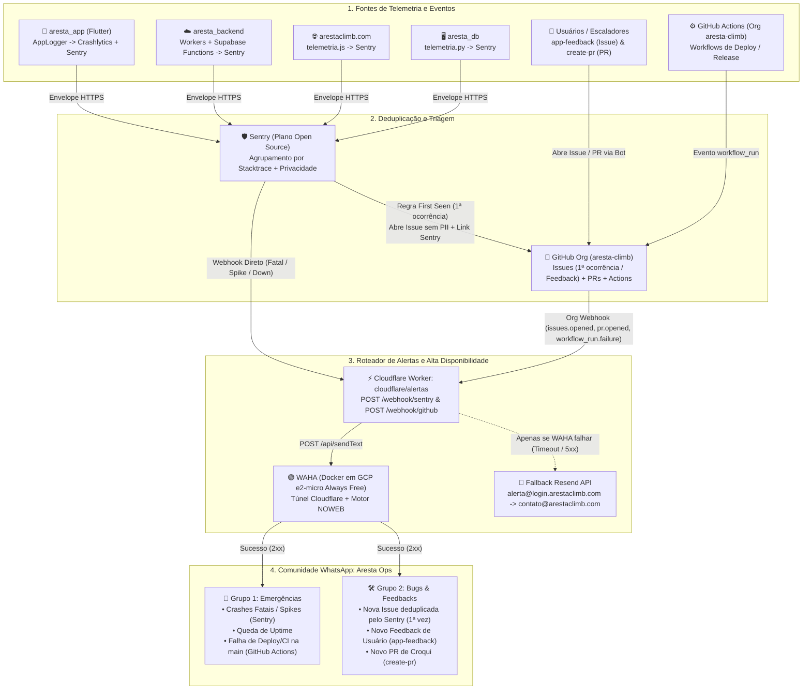

# Design

## Context

Conforme detalhado em `proposal.md`, o ecossistema Aresta Climb é distribuído em quatro frentes principais:
1. **`aresta_app`** (Flutter Android/iOS): Possui o `AppLogger` (`frontend/lib/services/firebase/app_logger.dart`) integrado ao Firebase Crashlytics, com filtragem de erros transitórios de rede (`isFalhaConexaoOuTimeout`) e injeção determinística para testes (`crashlyticsOverride`, `crashlyticsLogOverride`).
2. **`aresta_backend`** (Cloudflare Workers `catalogo`, `feedback`, `previa` e Supabase Edge Functions `git-proxy`, `create-pr`, `app-feedback`, `discord-feedback`): Atualmente registra erros apenas em `console.error`, sem envio centralizado nem alertas.
3. **`arestaclimb.com`** (Vite + ES Modules): Portal web e editor online (`editor.html`) sem captura de exceções de runtime dos navegadores dos usuários.
4. **`aresta_db`** (Editor Desktop Python + Pipeline de Catálogo): Já possui telemetria Sentry em `editor/core/telemetria.py` e testes de retrocompatibilidade do compilador (`preparar_submissao_lib_test.py`), carecendo apenas de alertas imediatos quando um workflow de deploy/CI falhar na branch `main`.

Restrições fundamentais do projeto:
- **Custo operacional zero**: Uso do plano **Sentry for Open Source**, **Google Cloud `e2-micro` (Always Free)** para o motor WhatsApp (**WAHA - motor NOWEB**), **Cloudflare Workers** e **Resend** (cota gratuita no domínio já verificado `login.arestaclimb.com`).
- **Privacidade em repositórios públicos**: Nenhum dado sensível de dispositivo/usuário deve vazar em issues públicas do GitHub; os detalhes completos permanecem restritos ao painel privado do Sentry, enquanto a issue pública no GitHub contém a assinatura do erro e o link direto para o Sentry.
- **Conformidade estrita com `AGENTS.md`**: Código, comentários, docstrings e testes 100% em português brasileiro; TDD (Red-Green-Refactor); espelhamento 1:1 de testes; 100% de cobertura comportamental; proibição de mocks para código interno; uso de bibliotecas `*_fake` determinísticas e testadas.

## Goals / Non-Goals

**Goals:**
- Centralizar erros de `aresta_app`, `aresta_backend`, `arestaclimb.com` e `aresta_db` no Sentry com deduplicação automática via abertura de GitHub Issues na 1ª ocorrência (*First Seen*).
- Preservar integralmente o Firebase Crashlytics no `aresta_app` realizando *dual-logging* de breadcrumbs e erros no `AppLogger` com cache offline em disco (`sentry_flutter`).
- Implementar um cliente HTTP Sentry Envelope leve e sem dependências externas (`relator_sentry.ts` + `relator_sentry_fake.ts`) compatível tanto com Cloudflare Workers (Node/V8 Isolates) quanto com Supabase Edge Functions (Deno).
- Construir o Worker roteador `aresta_backend/cloudflare/alertas` para receber webhooks assinados do Sentry e do GitHub Organization (`aresta-climb`) e roteá-los para dois grupos de WhatsApp (`🚨 Grupo 1 — Emergências` e `🛠️ Grupo 2 — Bugs & Feedbacks`) via gateway REST do WAHA.
- Garantir alta disponibilidade de alertas com fallback automático via API do **Resend** (`alerta@login.arestaclimb.com` $\rightarrow$ `contato@arestaclimb.com`) exclusivamente quando o envio ao WhatsApp falhar.
- Documentar passo a passo toda a configuração da infraestrutura (Sentry, GitHub Org Webhook, GCP `e2-micro` + Docker WAHA + Cloudflare Tunnel e Resend).

**Non-Goals:**
- Alterar código-fonte ou scripts Python dentro do repositório `aresta_db` (já instrumentado).
- Substituir o Firebase Crashlytics ou o Umami Analytics existentes.
- Expor a porta da VM do WAHA diretamente na internet pública sem proteção do Cloudflare Tunnel / chave de API.

## Decisions

### 1. Arquitetura Fim a Fim de Deduplicação e Roteamento em 2 Grupos de WhatsApp

- **Racional**: Usar o GitHub Issues como camada de deduplicação para erros gerais (*First Seen* no Sentry) unifica em um único evento (`issues.opened` no Webhook Organizacional do GitHub) tanto bugs inéditos detectados pelo Sentry em qualquer repositório quanto feedbacks enviados pelos usuários via `app-feedback`. Enquanto isso, emergências reais (Crashes fatais, picos de erro, queda de Uptime e falha de deploy na `main`) têm via expressa para o `🚨 Grupo 1 — Emergências`.

### 2. Dual-Logging no `AppLogger` do `aresta_app` sem Duplicar Chamadas na Aplicação
- **Decisão**: Manter `AppLogger` (`frontend/lib/services/firebase/app_logger.dart`) como fachada única de log no Flutter. Dentro de `logInfo` e `logAviso` (quando não estiver em `kDebugMode`), além de `crashlyticsLog(mensagem)`, invocar o callback injetável `sentryBreadcrumbOverride` (padrão: `Sentry.addBreadcrumb`). Dentro de `logError` e `logCrash`, além de `crashlytics.recordError(...)`, invocar o callback injetável `sentryCaptureOverride` (padrão: `Sentry.captureException(error, stackTrace: stackTrace, withScope: ...)`).
- **Racional**: Zero alterações nos dezenas de arquivos consumidores do `AppLogger`. O `sentry_flutter` gerencia automaticamente a fila offline em disco (`outbox`) de até 30 envelopes, enviando-os quando a conectividade retorna, com impacto desprezível de RAM (~1,5 MB) e dados (~2–4 KB gzip por erro). O filtro `AppLogger.isFalhaConexaoOuTimeout` continua protegendo ambos os serviços contra falsos positivos de falta de sinal na rocha.

### 3. Cliente Nativo Sentry Envelope (`relator_sentry.ts`) no `aresta_backend`
- **Decisão**: Implementar um cliente HTTP direto para o endpoint Sentry Envelope (`POST https://<host>/api/<project_id>/envelope/`) em `supabase/functions/compartilhado/relator_sentry.ts`, compartilhado entre as Supabase Edge Functions e os Cloudflare Workers, acompanhado de `relator_sentry_fake.ts`.
- **Alternativas consideradas**: Usar `@sentry/cloudflare` e `@sentry/deno`. Descartado porque adiciona pacotes pesados, divergências de bundler entre Deno e Wrangler, e dificulta a injeção de fakes determinísticos sem mocks exigida pelo Princípio V do `AGENTS.md`.
- **Racional**: O protocolo Envelope do Sentry consiste em apenas 3 linhas JSON separadas por `\n` (cabeçalho do envelope com DSN, cabeçalho do item `{"type":"event"}` e payload JSON do evento com `exception.values` e frames parseados de `error.stack`). Utilizando `fetch` padrão e `ctx.waitUntil(...)`, o envio ocorre em background com latência zero para o usuário final e sanitização explícita de cabeçalhos (`Authorization`, `Cookie`, `x-api-key`).

### 4. Gateway WhatsApp com WAHA (`NOWEB`) em GCP `e2-micro` + Cloudflare Tunnel
- **Decisão**: Rodar a imagem oficial `devlikeapro/waha` configurada com `WHATSAPP_DEFAULT_ENGINE=NOWEB` em conjunto com `cloudflare/cloudflared` via Docker Compose em uma VM `e2-micro` na região `us-central1` / `us-east1` (elegível ao *Always Free* da Google Cloud).
- **Racional**: O motor `NOWEB` do WAHA utiliza WebSockets diretos (sem abrir instâncias pesadas do Chromium), consumindo apenas ~120 MB de RAM e rodando com folga nos 1 GB da `e2-micro`. O `cloudflared` expõe o endpoint HTTPS internamente para o Worker `cloudflare/alertas` sem precisar abrir portas de firewall na VM e sem custo de IP fixo adicional.

### 5. Fallback por E-mail via Resend (`contato@arestaclimb.com`) Livre de Loops
- **Decisão**: No Worker `cloudflare/alertas`, o despachante de notificações tenta primeiro o envio ao WAHA (`POST ${WAHA_BASE_URL}/api/sendText` com timeout de 8 segundos). Se ocorrer exceção de rede, timeout ou resposta HTTP fora da faixa `200..299`, o despachante aciona imediatamente `POST https://api.resend.com/emails` autenticando com `RESEND_API_KEY`, enviando de `Aresta Alertas <alerta@login.arestaclimb.com>` para `contato@arestaclimb.com`.
- **Prevenção de Loop**: Falhas no envio ao WAHA ou ao Resend dentro do próprio `cloudflare/alertas` **nunca** disparam novos eventos que reacionem o webhook do Sentry, evitando tempestades infinitas de alertas.

## Risks / Trade-offs

- **[Desconexão ocasional da sessão do WhatsApp Web no WAHA]** → Mitigado pelo fallback automático imediato via Resend para `contato@arestaclimb.com` (que já avisa no corpo do e-mail que o gateway WAHA falhou e precisa de reconexão/verificação) e pela política `restart: unless-stopped` no Docker Compose.
- **[Exposição de tokens ou dados sensíveis em erros de backend]** → Mitigado pela função de sanitização obrigatória em `relator_sentry.ts`, que remove cabeçalhos `authorization`, `cookie`, `x-api-key` e `cf-access-client-secret` antes de montar o envelope.
- **[Volume de eventos em branches de desenvolvimento no GitHub Actions]** → Mitigado filtrando eventos `workflow_run` no `cloudflare/alertas` para notificar apenas quando `conclusion === "failure"` ocorrer na branch `main` ou em tags de release (`v*`).

## Migration Plan

1. Implementar e testar (100% de cobertura com TDD e Fakes) as bibliotecas `relator_sentry.ts`, o Worker `cloudflare/alertas`, a telemetria web em `arestaclimb.com` e o dual-logging do `AppLogger` no `aresta_app`.
2. Escrever o guia passo a passo completo `docs/guia_configuracao_observabilidade_e_alertas.md`.
3. Provisionar os projetos no Sentry, a VM `e2-micro` com WAHA + Cloudflare Tunnel, os 2 grupos na Comunidade do WhatsApp e os segredos no Cloudflare/Supabase seguindo o guia.
4. Em caso de necessidade de rollback em qualquer serviço, basta remover ou esvaziar a variável `SENTRY_DSN` (todos os clientes operam em modo *no-op* seguro quando o DSN está ausente).
