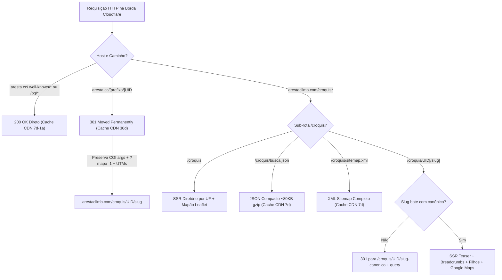

# Design

## Context

Veja `proposal.md` para a motivação de produto e SEO. Hoje o ecossistema Aresta possui três peças já operacionais, porém desconectadas para indexação orgânica e exploração web:
1. O banco Cloudflare D1 `aresta-catalogo` (sincronizado pelo pipeline `aresta_db/serving/sincronizar_d1_lib.py`) contém todos os croquis, grupos, setores e escaladas, mas `catalogo_croquis` ainda não armazena `latitude_e7`, `longitude_e7` nem `url_google_maps` (que já existem em `Pico` no `croqui.proto`).
2. O Worker `aresta_backend/cloudflare/app-links` responde em `aresta.cc` com páginas SSR individuais sem `sitemap.xml`, sem listagem de entidades filhas e sem links internos.
3. O site institucional `arestaclimb.com` roda no Cloudflare Pages (Vite MPA) e já hospeda `public/.well-known/assetlinks.json` e `apple-app-site-association`.

## Goals / Non-Goals

**Goals:**
- Servir `https://arestaclimb.com/croquis*` diretamente na borda via Worker Route compartilhando o mesmo Worker e binding D1 (`aresta-catalogo`), mantendo `arestaclimb.com` institucional intocado no Cloudflare Pages.
- Maximizar taxa de *Cache Hit* na CDN da Cloudflare (`> 98%`) ignorando query strings na chave de cache da CDN enquanto preserva todos os CGI args (`?mapa=1`, `utm_source`, `utm_medium`) no cliente e nos Deep Links nativos.
- Garantir URLs perenes e legíveis `/croquis/<uid>/<slug>` imunes a renomeações de vias/setores/picos.
- Oferecer Mapão nacional com ~42 pinos e busca instantânea client-side (`/croquis/busca.json`) a custo `R$ 0,00` (sem Google Maps JavaScript API).

**Non-Goals:**
- Compilar ou manter o aplicativo Flutter (`aresta_app`) para Flutter Web.
- Expor na web fotos de paredes com traçados vetoriais de vias, textos completos de betas, trilhas internas de aproximação ou caderneta esportiva (que permanecem exclusivos do aplicativo móvel).

## Decisions

### 1. Roteamento Unificado no Worker `app-links` via Worker Route `arestaclimb.com/croquis*`
- **Escolha**: Manter um único Cloudflare Worker (`aresta-app-links`) atendendo tanto `aresta.cc` / `www.aresta.cc` (Custom Domains) quanto a Worker Route `arestaclimb.com/croquis*` (`zone_name: "arestaclimb.com"`).
- **Alternativas consideradas**:
  - *Subdomínio `croquis.arestaclimb.com`*: Diluiria a autoridade de domínio (SEO) em relação à raiz `arestaclimb.com`.
  - *Pages Functions dentro do repositório `arestaclimb.com`*: Duplicaria bindings do D1, lógica OpenGraph/Design System e suíte Deno já consolidados em `aresta_backend`.

### 2. Formato de URL `/croquis/<uid>/<slug>` com `uid` na Frente
- **Escolha**: Posicionar o NanoID de 14 caracteres antes do slug (`https://arestaclimb.com/croquis/<uid>/<slug>`), construindo `<slug>` a partir da UF, nome do croqui e nome da entidade normalizados sem acentos (ex.: `mg-pedra-rachada-feijao-com-linguica`).
- **Racionalidade**: O parser (no Worker e no `DeepLinkRouteParser` do Flutter) lê determinísticamente `segments[1]` sem ambiguidade com hífens do nome e sem quebrar caso mensageiros trunquem o final de URLs longas. Se o nome mudar no `aresta_db`, acessos com o slug antigo recebem `301` para o slug atual sem jamais gerar `404`.

### 3. Estratégia de Cache na CDN Ignorando Query String + Leitura Client-Side de CGI Args
- **Escolha**: Emitir `Cache-Control: public, max-age=14400, s-maxage=604800, stale-while-revalidate=86400` em todas as rotas HTML/JSON/XML de `/croquis*` (e `s-maxage=2592000` nos redirects `301` de `aresta.cc`), combinada com Cache Rule na zona `arestaclimb.com` configurada com *Ignore query string* na Cache Key.
- **Racionalidade**: Evita *Cache Miss* por variações de campanha (`?utm_source=...`, `?fbclid=...`, `?mapa=1`). Como o navegador preserva a URL completa em `window.location.search`, o script leve no cliente extrai os CGI args para o evento Umami e anexa `window.location.search` ao link `aresta://arestaclimb.com/croquis/<uid>/<slug>` no mobile.

### 4. Mapão Nacional Leve (Leaflet + OpenFreeMap/CARTO) e Busca Lazy (`/croquis/busca.json`)
- **Escolha**: Carregar Leaflet (CSS/JS leve via CDN com SRI/fallback limpo) + tiles abertos (`OpenFreeMap` / `CARTOVoyager` sem API key) renderizando apenas 1 marcador por croqui que possua `latitude_e7` e `longitude_e7` não nulos. Para a busca global na página `/croquis`, o filtro inicial pesquisa imediatamente os cards de picos já presentes no DOM e faz *lazy fetch* único de `/croquis/busca.json` no primeiro foco/digitação na barra de pesquisa para buscar também entre todos os ~637 setores e ~4.318 escaladas em memória (`< 2ms` no cliente, respeitando folgadamente o orçamento de meio frame de `8ms`).
- **Alternativas consideradas**:
  - *Google Maps JS API*: Possui cobrança por carregamento na Web acima da franquia gratuita, violando a meta de custo operacional `R$ 0,00`.
  - *Busca via query SQL no Worker a cada tecla*: Consumiria milhares de invocações diárias de Worker e leituras D1 desnecessariamente.

### 5. Evolução Compatível de `catalogo_croquis`
- **Escolha**: Adicionar `latitude_e7 INTEGER`, `longitude_e7 INTEGER` e `url_google_maps TEXT` como colunas anuláveis ao final de `catalogo_croquis` em `sql/catalogo.sql` e opcionais/anuláveis em `CatalogoCroqui` (`openapi/catalogo.yaml`).
- **Extração em `aresta_db`**: Ler `primeiro_pico.localizacao.latitude` / `longitude` (quando `primeiro_pico.HasField("localizacao")` e diferente de `(0, 0)`) e `primeiro_pico.url_google_maps.strip() or None`. Se `url_google_maps` estiver vazio mas houver coordenadas válidas, o renderizador web gera `https://www.google.com/maps/search/?api=1&query=<lat>,<lng>`.

## Risks / Trade-offs

- **[Cache HTML na Cloudflare exige Cache Rule na Zona]** → Sem Cache Rule para `arestaclimb.com/croquis*`, a Cloudflare não armazena `text/html` na borda por padrão (`DYNAMIC`). Mitigação: documentar passo a passo a criação da Cache Rule (*Eligible for cache* + *Ignore query string*) nas instruções pós-deploy.
- **[Interceptação indevida de páginas institucionais por App Links]** → Se `apple-app-site-association` ou `AndroidManifest.xml` capturarem `/*` em `arestaclimb.com`, links como `/termos-de-uso` abririam o app sem rota válida. Mitigação: restringir `apple-app-site-association` a `"/croquis/*"` (`components: [{ "/": "/croquis/?*" }]`), `AndroidManifest.xml` a `android:pathPrefix="/croquis/"` e validar estritamente `validarUid(segments[1])` no `DeepLinkRouteParser`.
- **[Crawler do WhatsApp seguindo `301` de `aresta.cc`]** → Crawlers sociais seguem redirects `301` desde que rápidos e com `og:image` estável. Mitigação: manter `/og/<id_slug>.webp` servindo `200 OK` direto em `aresta.cc` (reaproveitado como `og:image` também em `arestaclimb.com/croquis/...`) e cachear o `301` na borda por 30 dias (`~10ms`).

## Migration Plan

1. **Contratos (`aresta_api`)**: Atualizar `sql/catalogo.sql`, `openapi/catalogo.yaml` e `openapi/app_links.yaml`, executar `python build.py` e rodar `pytest` com 100% de cobertura. Commitar e publicar em `aresta_api`.
2. **Catálogo e D1 (`aresta_db`)**: Atualizar `aresta_api` submodule, evoluir `gerar_catalogo_sqlite_lib.py`, `gerar_deltas_catalogo.py` e `sincronizar_d1_lib.py` (com bootstrap automático quando `latitude_e7` não existir no D1), regenerar `generated/catalogo.db`, rodar testes e publicar para acionar o workflow `Deploy para Cloudflare R2 e D1`.
3. **Worker SSR (`aresta_backend`)**: Atualizar `aresta_api` submodule, implementar os módulos de slug, consultas hierárquicas D1, `/croquis`, `/croquis/busca.json`, `/croquis/sitemap.xml`, teasers `/croquis/<uid>/<slug>`, redirects `301` de `aresta.cc` e `wrangler.jsonc` com 100% de cobertura no Deno, commitar, fazer push e executar `npx wrangler deploy`.
4. **Site Institucional (`arestaclimb.com`)**: Restringir `.well-known/apple-app-site-association` a `/croquis/*`, adicionar `Sitemap: https://arestaclimb.com/croquis/sitemap.xml` em `public/robots.txt`, incluir link `"Croquis"` no cabeçalho/navegação com 100% de cobertura no Vitest, commitar e publicar no Cloudflare Pages.
5. **Aplicativo Móvel (`aresta_app`)**: Atualizar `aresta_api` submodule, migrar `RepositorioCatalogo`, estender `DeepLinkRouteParser` + `AndroidManifest.xml` + `Runner.entitlements` com TDD e 100% de cobertura nos arquivos tocados, atualizar `assets/preload/catalogo.db` se aplicável, arquivar a change OpenSpec, commitar e publicar.
