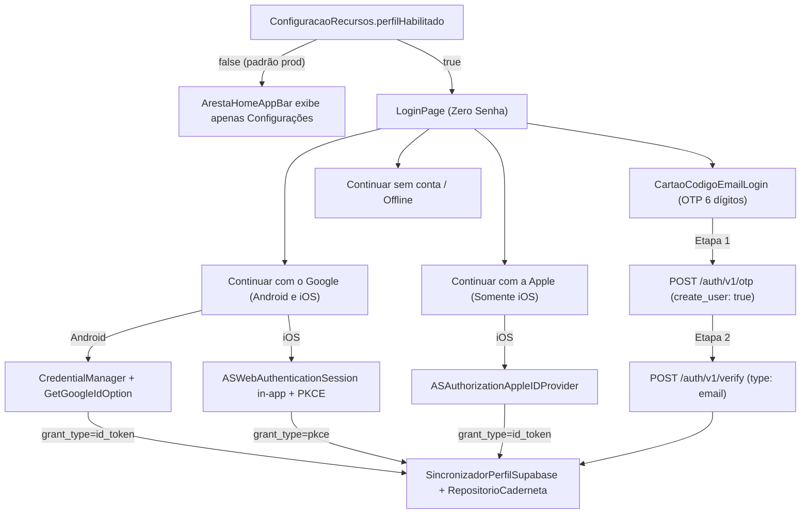

# Design

## Context

Conforme detalhado em `proposal.md`, o módulo de autenticação do `aresta_app` opera protegido atrás da flag de compilação `ConfiguracaoRecursos.perfilHabilitado` (`false` por padrão em compilações de produção). Ele compartilha a mesma instância Supabase (`yzkhiaoqtxvvcyyuwmqg.supabase.co`) já utilizada pelo `fixalog` (onde Sign in with Apple e Google já estão habilitados para `app.escalada.croquis, com.arestaclimb.fixalog`) e pelo `aresta_db` (onde o envio de código OTP de 6 dígitos via Resend SMTP já está ativo e validado em produção).

Atualmente, quatro problemas técnicos precisam ser resolvidos de forma coesa:
1. Existência de formulários, endpoints e estados de senha (`CartaoFormularioEmailLogin`, `/auth/v1/token?grant_type=password`, `/auth/v1/signup`).
2. Dependência de navegador externo (`url_launcher` + `app_links`) quando o canal nativo retorna `null` (como ocorre sempre no Google iOS hoje, pois `AppDelegate.swift` retorna `nil` para `solicitarIdTokenGoogle`), ausência de `com.apple.developer.applesignin` em `Runner.entitlements` e uso do SDK depreciado `play-services-auth` (`GoogleSignIn`) no Android.
3. Fallbacks silenciosos de contas locais fictícias (`usr_*`) em `ServicoAutenticacaoLocal` quando `anonKey` está vazia, além da issue `ARESTA-APP-G` (`LoginViewModel` notificando listeners após `dispose()`).
4. Classificação cega de `error is HttpException => true` em `AppLogger.isFalhaConexaoOuTimeout` e blocos `catch (_) {}` mudos em `LoginViewModel`, `SincronizadorPerfilSupabase`, `mapa_global.dart`, `mapa_marker.dart` e `comunidade_functions.dart`.

## Goals / Non-Goals

**Goals:**
- Eliminar 100% do código relacionado a senhas e ao callback OAuth por navegador externo, aplicando corte limpo (*Princípio VIII — Fail-Fast*).
- Unificar o protocolo de Magic Code OTP de 6 dígitos com o `aresta_db` (mesmos endpoints REST GoTrue, janela deslizante de 6 envios/60s e traduções de cooldown/expiração).
- Executar login Google e Apple 100% in-app (Android: `CredentialManager` + `GetGoogleIdOption`; iOS Google: `ASWebAuthenticationSession` com PKCE; iOS Apple: `ASAuthorizationAppleIDProvider` + `Runner.entitlements`), exibindo Apple apenas no iOS.
- Isolar credenciais sintéticas de teste em `ServicoAutenticacaoFake` (`test-only`, com teste espelhado 1:1), removendo qualquer conta falsa de produção.
- Preservar intacta a barreira `ConfiguracaoRecursos.perfilHabilitado` em toda a navegação.
- Distinguir com precisão cancelamento voluntário, erro de digitação do usuário, desconexão transitória e erro real de servidor/configuração para o Sentry.

**Non-Goals:**
- Alterar templates de e-mail ou configurações de SMTP no painel do Supabase (já operacionais com Resend).
- Liberar ou ativar por padrão a feature flag `ConfiguracaoRecursos.perfilHabilitado` em produção.
- Introduzir dependências externas pesadas como `supabase_flutter` ou `google_sign_in`.

## Decisions

### 1. Arquitetura Unificada de Autenticação Sem Senha

### 2. Google In-App no iOS via `ASWebAuthenticationSession` + PKCE do Supabase
- **Escolha**: Passar `urlAutorizacaoPkce` (`$baseUrl/auth/v1/authorize?provider=google&redirect_to=aresta://app.arestaclimb.com/auth-callback&code_challenge=...&code_challenge_method=s256`) e `esquemaCallback: "aresta"` no método `solicitarIdTokenGoogle` do canal `app.escalada.croquis/autenticacao_nativa`. No iOS, `AppDelegate.swift` abre `ASWebAuthenticationSession` in-app e devolve `{"callbackUrl": callbackURL.absoluteString, "cancelado": false}` (ou `{"cancelado": true}` imediatamente em `ASWebAuthenticationSessionError.canceledLogin`), permitindo que `ClienteSupabaseAutenticacao` troque o `code` via `POST /auth/v1/token?grant_type=pkce`.
- **Alternativas descartadas**:
  - *Criar um novo iOS OAuth Client ID no Google Cloud Console*: exigiria configuração manual externa e novo esquema `com.googleusercontent.apps.*` no `Info.plist`, enquanto o PKCE do Supabase com esquema `aresta` já está registrado em `Info.plist` e autorizado no Supabase.
  - *Manter `url_launcher` com Safari externo*: péssima UX, viola diretrizes da App Store e impede detectar quando o usuário fecha o navegador (travando o botão por 3 minutos).

### 3. Migração Android para `CredentialManager` sobre `FlutterActivity`
- **Escolha**: Substituir `com.google.android.gms:play-services-auth` por `androidx.credentials:credentials:1.3.0`, `androidx.credentials:credentials-play-services-auth:1.3.0`, `com.google.android.libraries.identity.googleid:googleid:1.1.1` e `org.jetbrains.kotlinx:kotlinx-coroutines-android:1.8.1`. Manter `MainActivity : FlutterActivity()` utilizando `CoroutineScope(SupervisorJob() + Dispatchers.Main)` cancelado em `onDestroy()`.
- **Racional**: Evita trocar a superclasse para `FlutterFragmentActivity`, preservando 100% da compatibilidade com o `LaunchTheme`, `moveTaskToBack`, `enableOnBackInvokedCallback="false"` e o fundo escuro de retomada em `onStop()`.

### 4. Taxonomia de Exceções de Autenticação e Inspeção HTTP no `AppLogger`

| Categoria | Exceção / Condição | UI (`LoginPage`) | Sentry / Crashlytics |
| :--- | :--- | :--- | :--- |
| Cancelamento voluntário | `ExcecaoAutenticacaoCancelada` (`cancelado == true`) | Nenhum erro exibido | Silencioso (nenhum log de erro) |
| Entrada inválida do usuário | `ExcecaoAutenticacao(ehErroUsuario: true)` (e-mail inválido, OTP errado/expirado, cooldown de reenvio) | `BannerAvisoLogin` amigável | Silencioso (não polui Sentry) |
| Desconexão / HTTP transitório | `SocketException`, `TimeoutException` ou HTTP `408, 429, 502, 503, 504` | `BannerAvisoLogin` offline amigável | `AppLogger.instance.logAviso` (breadcrumb) |
| Falha de servidor / config / bug | `ExcecaoAutenticacao(ehErroUsuario: false)` (`400 provider_disabled`, `401`, `403`, `500`, `anonKey` vazia, canal nulo) ou exceção inesperada | `BannerAvisoLogin` amigável | `AppLogger.instance.logError` com `StackTrace` |

- Em `AppLogger`, introduzimos a interface `ExcecaoComStatusHttp` (`int? get codigoStatusHttp`) implementada por `ExcecaoAutenticacao`, além da extração por regex de códigos HTTP de 3 dígitos em `HttpException.message`. `isFalhaConexaoOuTimeout` verifica primeiro o código HTTP: se existir código HTTP, retorna `true` exclusivamente para `{408, 429, 502, 503, 504}` e `false` para todos os demais (`400`, `401`, `403`, `404`, `422`, `500`).

### 5. Janela Deslizante de Reenvio OTP e Proteção Pós-`dispose`
- **Janela deslizante**: `LoginViewModel` mantém os timestamps (`DateTime`) dos envios bem-sucedidos de OTP nos últimos 60 segundos (com relógio injetável para testes determinísticos sem espera real) e um `Timer.periodic` de 1 segundo ativo apenas enquanto o limite de 6 envios na janela estiver atingido, expondo `segundosRestantesReenvio` e cancelando o timer em `dispose()`.
- **Correção `ARESTA-APP-G`**: `LoginViewModel` marca `_descartado = true` em `dispose()`, cancela o timer de contagem regressiva e substitui chamadas diretas a `notifyListeners()` por `_notificarOuvintes()` (que retorna imediatamente se `_descartado` for `true`).

## Risks / Trade-offs

- **[Risco] Capability Sign in with Apple no Apple Developer Portal** → Mitigação: `Runner.entitlements` recebe `com.apple.developer.applesignin`; caso o perfil de provisionamento no CI precise regerar com a capability ativa no App ID `app.escalada.croquis`, o build acusará explicitamente em vez de falhar silenciosamente em produção.
- **[Risco] Testes existentes que dependiam do fallback `anonKey == ''` em `ServicoAutenticacaoLocal`** → Mitigação: Introduzir `ServicoAutenticacaoFake` em `test/services/autenticacao/servico_autenticacao_fake.dart` (com `servico_autenticacao_fake_test.dart` espelhado 1:1) e atualizar `fabrica_dataset_caos.dart`, `funcoes_navegacao_test.dart` e `app_bar_home_aresta_test.dart` para usarem credenciais determinísticas explícitas de teste.

## Migration Plan

1. Atualizar `AppLogger` com inspeção de códigos de status HTTP via TDD.
2. Atualizar integrações nativas Android (`build.gradle.kts`, `MainActivity.kt`) e iOS (`Runner.entitlements`, `AppDelegate.swift`) e `AutenticadorNativo`.
3. Refatorar `tradutor_erros_autenticacao.dart`, `cliente_supabase_autenticacao.dart`, `servico_autenticacao.dart` e `sincronizador_perfil_supabase.dart` (removendo senhas, navegador externo e fallbacks sintéticos; adicionando OTP de 6 dígitos e logging no `AppLogger`), criando `ServicoAutenticacaoFake`.
4. Refatorar `LoginViewModel`, `componentes_login.dart`, `login.dart` e `servico_navegacao_deep_link.dart`, preservando `ConfiguracaoRecursos.perfilHabilitado`.
5. Corrigir blocos `catch` silenciosos remanescentes (`mapa_global.dart`, `mapa_marker.dart`, `comunidade_functions.dart`) e atualizar `README.md`s pertinentes.
