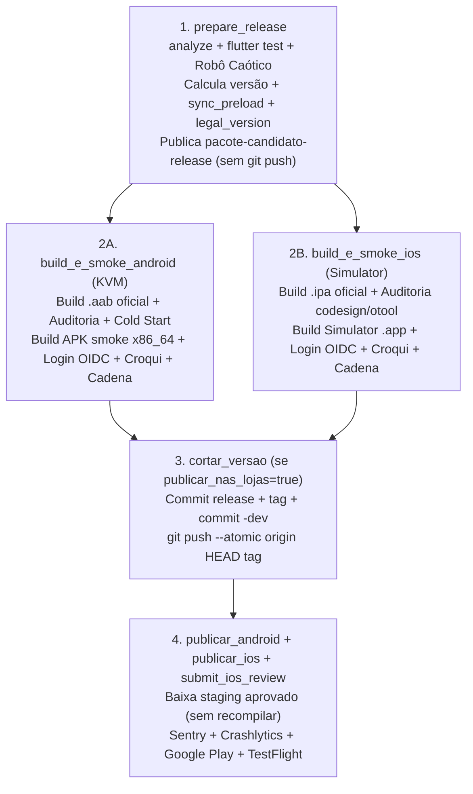

# Design

## Context

Veja `proposal.md` para a motivação. No Aresta App, quatro restrições arquiteturais do `AGENTS.md` e da suíte `frontend/test/architecture/` regem o desenho:
1. **Pureza absoluta dos binários de loja**: `lib/main.dart`, `.aab` e `.ipa` não podem conter código de smoke test nem desvios de OIDC acionáveis em celulares físicos.
2. **Isolamento de HTTP e Logging**: Qualquer módulo em `frontend/lib/` deve realizar chamadas HTTP exclusivamente por `ClienteHttpAresta.instancia` (`isolamento_cliente_http_test.dart`) e logs exclusivamente por `AppLogger.instance` (`isolamento_logs_arquitetura_test.dart`).
3. **100% de cobertura comportamental e espelhamento 1:1**: Módulos em `frontend/lib/` devem ter 100% de linhas exercitadas em `frontend/test/` sem ramos mortos.

## Goals / Non-Goals

**Goals:**
- Garantir zero bytes de smoke test nos artefatos oficiais `.aab` e `.ipa`, verificado por auditoria binária automatizada no CI e teste de Cold Start puro no Android Emulator.
- Validar de ponta a ponta em Android Emulator KVM (`x86_64`) e iOS Simulator (`arm64`) a inicialização nativa (`Workmanager`, notificações, `sqflite`, `assets/preload/`), aceite de Termos de Uso, login OIDC pelo `MethodChannel` nativo, abertura/navegação em croqui Protobuf (`Pico` → `Setor` → `Escalada`) e persistência de `Cadena` na caderneta.
- Alinhar a topologia transacional de 4 estágios de `release_new_app_version.yml`, `build_android.yml` e `build_ios.yml` em paridade total com o Fixalog, incluindo `git push --atomic` e `publicar_nas_lojas`.

**Non-Goals:**
- Alterar o fluxo de autenticação sem senha (Google, Apple, OTP 6 dígitos e modo sem conta) já consolidado em `lib/main.dart`.

## Decisions

### 1. Entrypoint Dedicado (`lib/services/smoke_ci/main_smoke_ci.dart`) + Guardas Nativas
- **Escolha**: Manter `frontend/lib/main.dart` intocado e isolar o auto-smoke em `frontend/lib/services/smoke_ci/` (`configuracao_smoke_ci.dart`, `executor_jornada_smoke.dart` e `main_smoke_ci.dart`), utilizando `ClienteHttpAresta.instancia` e `AppLogger.instance`.
  - No Android (`build.gradle.kts` + `AndroidManifest.xml` + `MainActivity.kt`), `BuildConfig.ARESTA_SMOKE_CI` e `usesCleartextTraffic` são `false` por padrão no `.aab` oficial (eliminados pelo R8) e ativados apenas no APK descartável de CI (`ORG_GRADLE_PROJECT_arestaSmokeCi=true`), exigindo hardware virtual QEMU (`ranchu`/`goldfish`) e loopback (`10.0.2.2`, `127.0.0.1`, `localhost`).
  - No iOS (`AppDelegate.swift`), o canal `app.escalada.croquis/smoke_ci` e o retorno local de `idToken` em `solicitarIdTokenGoogle`/`solicitarIdTokenApple` ficam estritamente sob `#if targetEnvironment(simulator)`.

### 2. Topologia Transacional em Quatro Estágios com Preload e Termos Legais Candidatos

- **Racional**: No Aresta App, o passo de preparação também executa `dart tool/sync_preload.dart` atualizando `frontend/assets/preload/`. Empacotar `pubspec.yaml`, `legal_version.g.dart`, `assets/preload/` e o SHA do submódulo legal em um tarball candidato garante que Android, iOS e `cortar_versao` usem exatamente os mesmos bytes sem sujar `main` caso algum smoke test falhe.

## Risks / Trade-offs

- **[Espaço em disco no runner Android com NDK + Emulador]** → Mitigação: Incluir etapa explícita de liberação de pacotes não utilizados (`/usr/share/dotnet`, `/opt/ghc`, `/usr/local/share/boost`, NDKs antigos) antes da compilação no `build_android.yml`, espelhando a otimização comprovada do Fixalog.
- **[Dependência de croquis reais na jornada de smoke]** → Mitigação: Se `assets/preload/` já possuir picos pré-carregados, o executor abre um croqui real do preload **e** valida adicionalmente um croqui Protobuf determinístico servido pelo `ServidorSmokeCi` local, garantindo cobertura determinística independente do catálogo remoto.

## Migration Plan

1. Implementar `frontend/lib/services/smoke_ci/`, guardas nativas Kotlin/Swift e ferramentas CLI (`auditar_binario_loja.dart`, `servidor_smoke_ci.dart`, `smoke_test_pacote.dart`) em TDD com 100% de cobertura.
2. Atualizar `release_new_app_version.yml`, `build_android.yml` e `build_ios.yml` e criar `pipeline_release_arquitetura_test.dart`.
3. Disparar `release_new_app_version.yml` com `publicar_nas_lojas: false` e confirmar evidência verde em Android e iOS.
