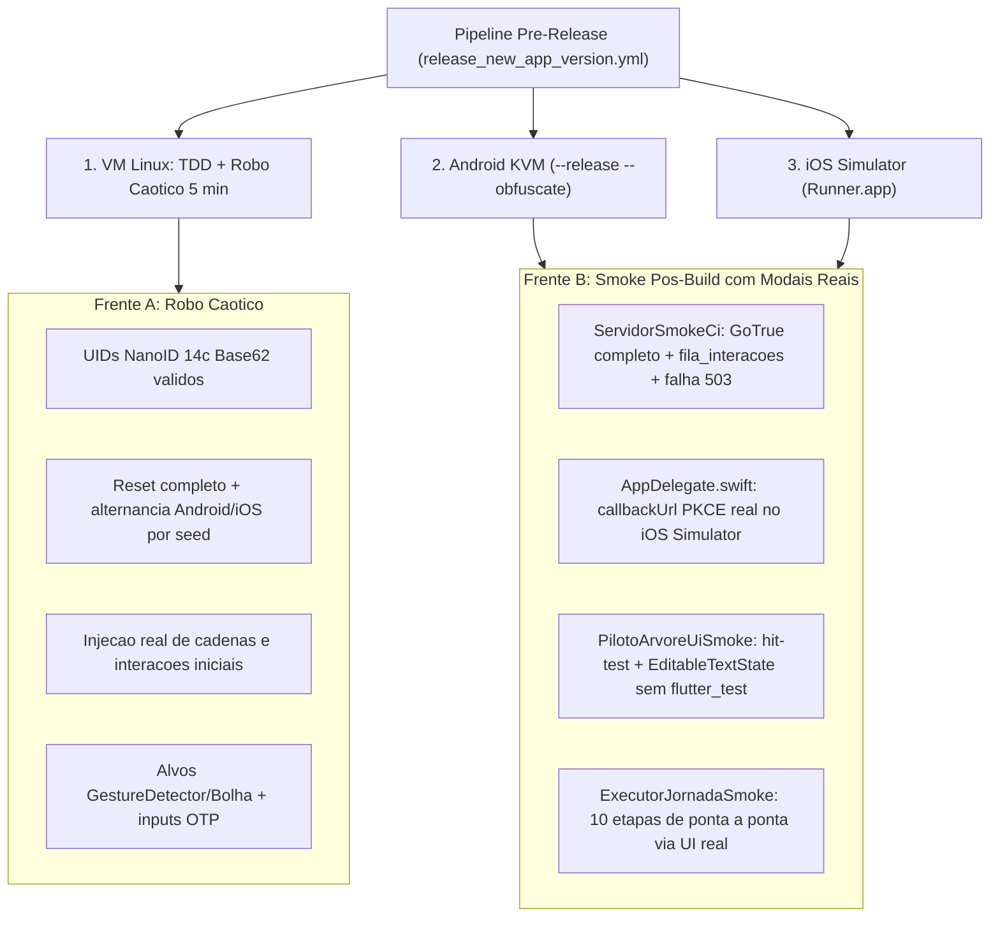

# Design

## Context

Veja [proposal.md](proposal.md) para a motivação desta entrega. Hoje o pipeline de pré-lançamento ([release_new_app_version.yml](../../../.github/workflows/release_new_app_version.yml)) possui duas camadas complementares:
1. **Campanha Exploratória Rápida (VM Linux):** `robo_caotico_exploratorio_test.dart` executa centenas de sessões em 5 minutos com *shrinking* por busca binária (`ddmin`), ideal para expor `RenderFlex overflow`, erros de estado após `dispose` e regressões de navegação.
2. **Smoke Test Determinístico Pós-Build (Android Emulator KVM e iOS Simulator):** compila binários descartáveis reais (`--release --obfuscate` no Android e `--simulator` no iOS) a partir de `lib/services/smoke_ci/main_smoke_ci.dart`, validando SQLite, Protobuf v5, R8, tree-shaking e canais nativos contra o servidor local `ServidorSmokeCi`.

Restrições críticas preservadas pelo projeto:
- Nenhum código fora de `lib/services/smoke_ci/` pode importar ou referenciar artefatos de smoke (`isolamento_smoke_ci_test.dart` e `auditar_binario_loja.dart`).
- Nenhum arquivo em `lib/services/smoke_ci/` pode importar `flutter_test` (o binário descartável é compilado em modo `release`/`simulator`).
- A camada de UI (`pages/` e `widgets/`) segue MVVM estrito (`isolamento_mvvm_modulos_test.dart`), mantendo arquivos abaixo de 650 linhas e espelhamento 1:1 de testes em `test/`.

## Goals / Non-Goals

**Goals:**
- Cobrir 100% dos caminhos novos de autenticação sem senha (Magic Code OTP, Google Android `id_token`, Google iOS `PKCE`, Apple iOS `id_token` + `nonce`, logout, refresh token e exclusão de conta) e de interações comunitárias (cadena, voto de grau, comentários com edição, alertas Waze com fila offline e confirmação `+1`) tanto no Robô Caótico quanto no Smoke Pós-Build.
- Exercitar **modais e páginas reais na árvore de widgets** durante o Smoke Pós-Build para detectar quebras de ofuscação R8, tree-shaking de ícones/fontes e overflow em telas móveis reais.
- Corrigir a aderência dos UIDs do dataset caótico ao padrão canônico NanoID Base62 de 14 caracteres (`validarUid`).

**Non-Goals:**
- Executar o Robô Caótico de 5 minutos dentro do Android Emulator KVM / iOS Simulator durante o release (mantido na VM Linux para maximizar sessões por minuto, enquanto os simuladores executam a jornada determinística completa pós-build).
- Alterar regras de negócio do aplicativo de produção ou relaxar regras da auditoria binária de `.aab` e `.ipa`.

## Decisions

| Decisão | Alternativa Considerada | Justificativa |
| :--- | :--- | :--- |
| Conduzir a UI pós-build por `ValueKey<String>` com `PilotoArvoreUiSmoke` sobre `WidgetsBinding`/`GestureBinding` | Chamar métodos de ViewModels/serviços diretamente sem abrir modais | Ofuscação AOT/R8 renomeia símbolos Dart, mas preserva `ValueKey<String>`. Tocar e digitar na árvore real valida layout, `inputFormatters`, R8 e tree-shaking em modais reais sem importar `flutter_test`. |
| Bombeamento híbrido no `PilotoArvoreUiSmoke` (VSync nativo em device + fallback `handleBeginFrame`/`handleDrawFrame` quando `hasScheduledFrame` após timeout curto) | Usar apenas `Future.delayed` ou apenas `handleDrawFrame` | Em emuladores reais o VSync do motor dirige os quadros naturalmente; dentro de `tester.runAsync` no `flutter test`, não há VSync automático, então o fallback permite rodar a mesma jornada determinística na suíte unitária em < 2s. |
| Simular falha offline no `ServidorSmokeCi` via endpoint `POST /__smoke__/falhar-proxima-escrita-fila` retornando HTTP `503` | Fechar socket abruptamente ou desligar servidor | `AppLogger.isFalhaConexaoOuTimeout` classifica `ExcecaoHttpFilaInteracoes(503)` como falha transitória esperada (`logAviso` sem `logError`), retendo a interação na fila offline de forma determinística e sem flakiness de socket. |
| Alternar `TargetPlatform.android` e `TargetPlatform.iOS` por `seed` em `AmbienteAppCaos` com `ServicoAutenticacaoFake` isolado por sessão | Manter plataforma fixa (`android`) e singleton compartilhado | Sem alternância de plataforma o botão da Apple nunca entra na árvore no Robô Caótico; sem reset por sessão, o login de uma semente vaza para todas as demais. |

## Risks / Trade-offs

- **Risco:** `PilotoArvoreUiSmoke.tocarPorKey` falhar por diferença de tamanho de janela em testes unitários vs emuladores → **Mitigação:** Chamar `Scrollable.ensureVisible` antes de calcular o centro do `RenderBox` e configurar viewport móvel realista (`360x800` lógicos) nos testes de widget do executor.
- **Risco:** Campanha do Robô Caótico descobrir novo crash ou overflow ao destravar os fluxos de Login OTP, Apple e Alertas Waze → **Mitigação:** Executar campanha local de validação (`REPORTAR_SENTRY_CAOS=false`) antes de arquivar a change e corrigir eventuais defeitos encontrados pela raiz.
- **Risco:** `executor_jornada_smoke.dart` ou `servidor_smoke_ci.dart` crescer além do limite modular de 650 linhas → **Mitigação:** Manter lógica de condução de árvore isolada em `piloto_arvore_ui_smoke.dart` e manter os métodos auxiliares enxutos e coesos.
