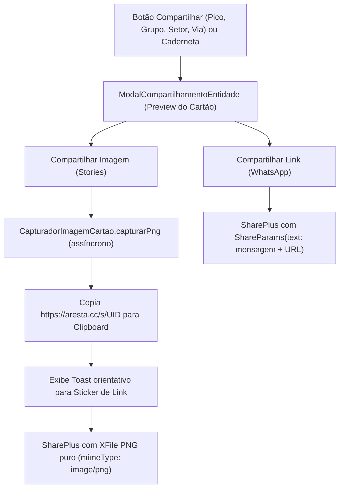

# Design: Compartilhamento Rico com Cartões Visuais para Stories e Link Rápido

## Context

Veja `proposal.md` para a motivação de negócio e aquisição orgânica. Tecnicamente, o aplicativo utiliza `share_plus` via `ServicoCompartilhamento`, que hoje dispara apenas `ShareParams(text: ...)` (`text/plain`). Tanto no Android (`Intent.ACTION_SEND`) quanto no iOS (`UIActivityViewController`), o destino **Instagram Stories** não aparece para conteúdos `text/plain`, exigindo mídia `image/*` ou `video/*`. Ao mesmo tempo, enviar imagem junto com texto no WhatsApp faz o mensageiro exibir foto com legenda e suprimir o preview OpenGraph clicável gerado pelo Worker `aresta.cc/s/<uid>`.

## Goals / Non-Goals

**Goals:**
- Habilitar o destino **Instagram Stories** (e WhatsApp Status) enviando um cartão editorial PNG limpo (`image/png`).
- Preservar integralmente o card OpenGraph clicável do `aresta.cc/s/<uid>` para compartilhamentos de **Link Rápido** (`text/plain`) no WhatsApp e mensageiros.
- Unificar o fluxo para **Pico**, **Grupo**, **Setor** e **Escalada** com um único modelo de apresentação (`DadosCartaoCompartilhamento`), um único cartão editorial (`CartaoCompartilhamentoAresta`) e um único BottomSheet (`ModalCompartilhamentoEntidade`).
- Garantir que `notasPrivadas` da caderneta nunca vazem para o cartão visual gerado.
- Capturar o PNG de forma assíncrona fora do caminho crítico síncrono, mantendo a UI fluida dentro do orçamento de meio frame.

**Non-Goals:**
- Integração com Intents proprietários específicos do Meta SDK (`com.instagram.share.ADD_TO_STORY`) ou publicação automática via API externa.
- Geração de QR Code no cartão visual (decisão explícita de produto em favor de `arestaclimb.com` + `@arestaclimb`).
- Edição livre pelo usuário de textos/cores ou upload de fotos próprias da galeria nesta etapa.

## Decisions

### 1. Separação Explícita entre `image/png` (Stories) e `text/plain` (WhatsApp) no BottomSheet

Em vez de enviar `files + text` em uma única chamada do `share_plus`, o `ModalCompartilhamentoEntidade` apresenta a pré-visualização do cartão e duas ações claras:

- **Por quê:** Enviar apenas `XFile(..., mimeType: 'image/png')` sem `text` evita que o Share Sheet do sistema trate o payload como texto+anexo misto e garante compatibilidade direta com o Instagram Stories; copiar `https://aresta.cc/s/<uid>` para a área de transferência oferece um caminho sem atrito para o usuário colar no Sticker de Link do Instagram.
- **Alternativa descartada:** Abrir `share_plus` direto com imagem+texto ao tocar no ícone da AppBar quebraria o preview clicável do `aresta.cc/s/<uid>` no WhatsApp.

### 2. Modelo Único `DadosCartaoCompartilhamento` e Proteção Estrutural de Privacidade

Todas as 4 entidades são convertidas para o modelo imutável `DadosCartaoCompartilhamento` antes de chegar à camada de UI do cartão (`CartaoCompartilhamentoAresta`).

| Entidade | Cascata da Imagem Heroica | Destaque Principal | Resumo / Selo |
| :--- | :--- | :--- | :--- |
| **Pico** | `croqui.caminhoThumbnail` → 1º mapa em `pico.mapasGerais` | Nome do Pico + `estado` | Setores, escaladas e modalidades |
| **Grupo** | `grupo.caminhoImagemCapa` → 1º mapa do grupo → capa/mapa de setor filho → thumbnail do croqui | Nome do Grupo + nome do Pico | Setores, escaladas e modalidades |
| **Setor** | `setor.caminhoImagemCapa` → 1º mapa do setor → capa/mapa de `grupoContext` → thumbnail do croqui | Nome do Setor + `Pico • Grupo` | Escaladas, faixa de graus e modalidades |
| **Escalada** | `estadoCroqui.mapasMiniatura` / `escalada.mapas` → capa/mapa de setor/grupo → thumbnail do croqui | Nome da Via + `grauDestaque` + `★ CLÁSSICA` + `Pico • Setor` | Pílula `LINHA #N`, atributos técnicos e `SeloPessoalCompartilhamento` |

- **Proteção de privacidade:** `SeloPessoalCompartilhamento` possui somente `ehCadena` (`bool`) e `textoResumo` (`String`), não contendo nenhum campo de `notasPrivadas`. Assim é estruturalmente impossível o cartão renderizar anotações pessoais.
- **Identidade visual fixa no cartão:** `CartaoCompartilhamentoAresta` utiliza explicitamente `AppColors.dark` para preservar o contraste e a estética editorial nas imagens postadas nos Stories independentemente do tema claro/escuro ativo no dispositivo.

### 3. Captura Assíncrona e Testabilidade sem Mocks Internos

- `CapturadorImagemCartao.capturarPng` converte o `RenderRepaintBoundary` com `pixelRatio: 3.0` via `toImage` e `toByteData(format: ui.ImageByteFormat.png)` de maneira 100% assíncrona e descarta o `ui.Image` no bloco `finally`.
- O `ServicoCompartilhamento` grava o `.png` em um diretório temporário isolado (`aresta_share_*`) e limpa o diretório no `finally` após o retorno do `SharePlus`.
- Para manter testes determinísticos em 100% sem mocks internos (`AGENTS.md` Princípio V), `ServicoCompartilhamentoFake` em `frontend/test/fakes/` estende `ServicoCompartilhamento`, permitindo injetar captura em memória e registrar textos, imagens PNG e entradas copiadas para o clipboard.

## Risks / Trade-offs

- **Falha ou ausência de imagem de capa/croqui (modo offline parcial)** → O `CartaoCompartilhamentoAresta` colapsa a área da foto sem espaço vazio quebrado quando `caminhoImagemHeroi` é nulo ou falha ao carregar, mantendo o cartão limpo e legível.
- **Compatibilidade com destinos que exibem apenas o PNG** → Como o Instagram Stories descarta textos enviados junto com arquivos, o rodapé editorial traz `arestaclimb.com` e `@arestaclimb` impressos discretamente e o link curto vai para o clipboard.
- **Uso de ícone distinto no selo da caderneta** → O atalho no selo de ascensão usa `Icons.ios_share_rounded` para não colidir com o botão da `AppBar` (`Icons.share_outlined`).
