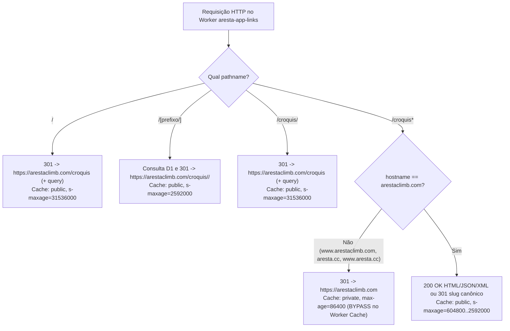

# Design

## Context

Veja `proposal.md` para a motivação completa. O Worker `aresta-app-links` atende múltiplos domínios (`aresta.cc`, `www.aresta.cc`, `arestaclimb.com/croquis*`, `www.arestaclimb.com/croquis*`) com `"cache": { "enabled": true }` em `wrangler.jsonc`. No Cloudflare Workers Caching, o `hostname` não compõe a chave de cache — apenas `(entrypoint, versão, pathname + search)`.

## Goals / Non-Goals

**Goals:**
- Garantir o invariante anti-loop no cache compartilhado do Worker para todos os domínios e rotas atendidos.
- Consolidar todos os redirecionamentos de `aresta.cc` e `www.aresta.cc` em um único salto `301` direto para `https://arestaclimb.com/croquis*`.

**Non-Goals:**
- Desativar `cache.enabled` no `wrangler.jsonc` ou alterar rotas no Cloudflare Dashboard (Redirect Rules de zona) fora do escopo do Worker.
- Alterar o contrato OpenAPI em `aresta_api/openapi/app_links.yaml`.

## Decisions

### Invariante de Segurança para Workers Caching sem `hostname` na chave

- **Escolha**: Aplicar `Cache-Control: public, s-maxage=...` em redirecionamentos `301` **somente** quando `destino.pathname !== origem.pathname`. Sempre que o redirecionamento alterar apenas o `hostname` mantendo o mesmo `pathname`, emitir `Cache-Control: private, max-age=86400` (`CABECALHO_CACHE_REDIRECIONAMENTO_HOST_PRIVADO`), forçando `BYPASS` na borda do Worker.
- **Alternativas consideradas**:
  - *Desligar `cache.enabled` e depender só de Cache Rules de zona*: Exigiria regras manuais idênticas em duas zonas distintas (`aresta.cc` e `arestaclimb.com`) e aumentaria invocações de Worker para `aresta.cc`.
  - *Manter `www.aresta.cc -> aresta.cc` com `private`*: Manteria um salto extra (`2` redirects) prejudicial ao *crawl budget* de SEO em vez de resolver em `1` pulo direto.

| Origem | Destino (`301` em 1 pulo) | `Cache-Control` | Efeito no Workers Cache |
| :--- | :--- | :--- | :--- |
| `aresta.cc/` e `www.aresta.cc/` | `https://arestaclimb.com/croquis` *(+ query)* | `public, max-age=86400, s-maxage=31536000` | Seguro (muda para `/croquis`) |
| `aresta.cc/[prefixo/]<uid>` e `www.aresta.cc/[prefixo/]<uid>` | `https://arestaclimb.com/croquis/<uid>/<slug>` *(+ CGI/UTMs)* | `public, max-age=86400, s-maxage=2592000, stale-while-revalidate=86400` | Seguro (muda para `/croquis/<uid>/<slug>`) |
| `*/croquis/` *(com barra final)* | `https://arestaclimb.com/croquis` *(+ query)* | `public, max-age=86400, s-maxage=31536000` | Seguro (muda de `/croquis/` para `/croquis`) |
| `www.arestaclimb.com/croquis*`, `aresta.cc/croquis*`, `www.aresta.cc/croquis*` | `https://arestaclimb.com/croquis*` | `private, max-age=86400` | `BYPASS` no cache compartilhado |

## Risks / Trade-offs

- **[Cache antigo `max-age=86400` nos navegadores dos usuários]** $\rightarrow$ Mitigação: Novo deploy do Worker invalida automaticamente o cache na borda da Cloudflare (`cross_version_cache` é `false` por padrão); no cliente local que já recebeu o `301` antigo para si mesmo, o cache expira em 24h ou mediante limpeza de cache/aba anônima.
